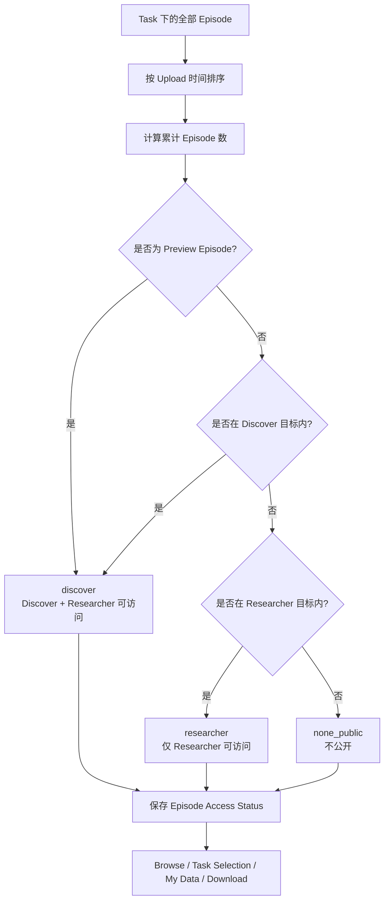

# Membership Pool PRD（草案）

## 1. 背景与目标

将每个 Task 的公开预览视频数量固定为 **48 个 Episode**。这些 Episode 在 UI 中可以预览和选择，相当于一个 Task 最多可以执行 3 次 `Expand`。

同时，根据会员等级为每个 Task 的 Episode 划分不同的访问池：

- Discover 用户的目标访问比例为 10%；
- Researcher 用户的目标访问比例为 25%；
- 没有进入会员访问池的 Episode 不公开。

系统需要由后端统一计算和保存每个 Episode 的访问状态，前端不能自行推算访问范围。

## 2. 会员方案

| 会员等级 | 月费 | 可访问范围 | 每月 Episode 配额 |
| --- | ---: | ---: | ---: |
| Discover | $9 | 每个 Task 10% | 100 Episodes / 月 |
| Researcher | $89 | 每个 Task 25% | 1,500 Episodes / 月 |

说明：

- “可访问范围”表示用户首次获取数据时可选择的 Episode 池；
- “每月 Episode 配额”表示用户一个月内实际能够加入或下载的新增 Episode 数量；
- Researcher 的访问池包含 Discover 的访问池。

## 3. Task 预览规则

每个 Task 固定展示最多 48 个可预览、可选择的 Episode：

```text
公开预览 Episode（最多 48）
    ⊆ Discover 可访问池（目标比例 10%）
    ⊆ Researcher 可访问池（目标比例 25%）
    ⊆ Task 全部 Episode
```

规则：

1. 一个 Episode 如果被选为 Preview Video，则必须同时对 Discover 和 Researcher 开放；
2. Discover 和 Researcher 用户看到的公开预览集合相同；
3. Researcher 的优势是可访问池更大，而不是公开预览数量更多；
4. 用户选择整个 Task 时，可选范围不应只限于 48 个 Preview Episode，而应由后端根据会员等级返回完整访问池。

## 4. Episode 访问状态

后端需要为每个 Episode 分配以下访问状态之一：

| 状态 | Discover | Researcher | 说明 |
| --- | :---: | :---: | --- |
| `none_public` | ❌ | ❌ | 不属于公开会员访问池 |
| `discover` | ✅ | ✅ | Discover 和 Researcher 均可访问 |
| `researcher` | ❌ | ✅ | 仅 Researcher 可访问 |

> `discover` 表示 Discover 及以上会员均可访问；Researcher 访问池由 `discover + researcher` 两部分组成。

## 5. 后端设计要求

后端服务负责：

1. 统计每个 Task 当前的 Episode 总数；
2. 计算 Discover 和 Researcher 的目标访问数量；
3. 确定最多 48 个公开 Preview Episode；
4. 按 Upload 时间顺序对 Upload 进行排序；
5. 根据累计 Episode 数量给每个 Upload 下的 Episode 分配访问状态；
6. 保存访问状态，供 Browse、整 Task 选择、My Data 和下载接口统一使用；
7. 当 Task 新增 Upload 或 Episode 时，重新计算或增量更新访问状态。

### 5.1 目标数量

设一个 Task 的 Episode 总数为 `N`：

```text
preview_limit = 48
discover_target = ceil(N / 10)
researcher_target = N × 25%
```

Discover 按 `ceil(N / 10)` 向上取整，保证存在余数时不会少于 10% 的目标范围。Researcher 的取整方式仍需确认。

### 5.2 Preview 优先级

如果一个 Episode 已被选为 Preview Video：

```text
access_status = discover
```

即该 Episode 必须同时进入 Discover 和 Researcher 的访问范围。后续分池计算不能把 Preview Episode 降级为 `researcher` 或 `none_public`。

### 5.3 按 Upload 分配访问状态

在同一个 Task Category 内：

1. 按 Upload 时间排序；
2. 计算每个 Upload 对应的 Episode 数量；
3. 计算截至当前 Upload 的累计 Episode 数；
4. 根据累计数量与 Discover、Researcher 目标数量的关系，给整个 Upload 分配访问状态。

初步规则：

| 累计 Episode 数量 | Upload 访问状态 |
| --- | --- |
| 未超过 Discover 目标数量 | `discover` |
| 超过 Discover、但未超过 Researcher 目标数量 | `researcher` |
| 超过 Researcher 目标数量 | `none_public` |

Preview Episode 始终优先保持 `discover`，不受所在 Upload 的默认状态影响。

## 6. 分配示例

### 6.1 Task 数据

以 `Pick and Place` Task 为例：

```text
Task Episode 总数：1,000
Discover 目标：1,000 × 10% = 100
Researcher 目标：1,000 × 25% = 250
```

前三个 Upload：

| Upload | Episode 数量 | 累计数量 |
| --- | ---: | ---: |
| Upload 1 | 30 | 30 |
| Upload 2 | 50 | 80 |
| Upload 3 | 60 | 140 |

### 6.2 分配结果

| Upload | 累计范围 | 分配状态 | 原因 |
| --- | ---: | --- | --- |
| Upload 1 | 1–30 | `discover` | 累计 30，未超过 Discover 目标 100 |
| Upload 2 | 31–80 | `discover` | 累计 80，未超过 Discover 目标 100 |
| Upload 3 | 81–140 | `researcher` | 本 Upload 跨过 Discover 边界，但仍在 Researcher 目标 250 内 |
| 后续 Upload | 超过 250 的部分 | `none_public` | 超出 Researcher 访问范围 |

在这个示例中：

- Discover 可以访问 Upload 1 和 Upload 2 中的 Episode，以及所有被指定为 Preview 的 Episode；
- Researcher 可以访问 Discover 池，再加上 Upload 3 及后续仍处于 25% 范围内的 Upload；
- 超过 Researcher 范围、且不是 Preview 的 Episode 不公开。

## 7. 整个 Task 的选择逻辑

当用户在 UI 中勾选整个 Task 时，前端调用后端接口，由后端根据会员等级返回可选择的 Episode ID：

| 用户等级 | 后端选择范围（以 1,000 个 Episode 为例） |
| --- | ---: |
| Discover | 目标为 100 个可访问 Episode |
| Researcher | 目标为 250 个可访问 Episode |

最终选择数量还应受到以下条件限制：

- 用户当月剩余 Episode 配额；
- 用户已经拥有的 Episode；
- Episode 当前是否有效、可下载；
- 会员等级对应的访问池；
- Preview Episode 的强制可访问规则。

前端应提交或使用后端返回的明确 `episode_ids`，不应根据页面上的 48 个 Preview Episode 自行推算整个 Task 的可访问集合。

## 8. 数据流



## 9. 验收标准

1. 每个 Task 最多展示 48 个 Preview Episode；
2. Preview Episode 对 Discover 和 Researcher 均可访问；
3. Researcher 访问池包含 Discover 访问池；
4. Discover 只能首次获取 `discover` Episode；
5. Researcher 可以首次获取 `discover` 和 `researcher` Episode；
6. `none_public` Episode 不能通过公开会员入口首次获取；
7. 整 Task 选择由后端根据会员等级和月配额计算；
8. 页面只展示 48 个 Preview，不代表整 Task 只能选择 48 个 Episode；
9. 新增 Upload 后，访问状态可以稳定、可重复地重新计算；
10. Browse、My Data、下载和 Package 等入口使用同一套后端访问状态。

## 10. 待确认问题

| 编号 | 待确认项 | 当前文档中的冲突或缺口 |
| --- | --- | --- |
| Q1 | Researcher 的 25% 如何取整？ | Discover 已明确使用 `ceil(N / 10)`；Researcher 仍需明确取整方式 |
| Q2 | Task 总数较少、48 个 Preview 超过 10% 时如何处理？ | 需要确认 Discover 池是否以 48 为硬下限 |
| Q3 | Upload 时间排序方向是什么？ | 需要明确从最早到最新，还是从最新到最早 |
| Q4 | 一个 Upload 跨越比例边界时是否整批进入更高等级？ | 示例中 Upload 3 从累计 80 增至 140，被整体放入 Researcher；需确认是否允许拆分 Upload |
| Q5 | 新 Upload 到达后是否允许历史 Episode 改变等级？ | 需要明确重新洗牌、增量分配或保持既有状态 |
| Q6 | “Expand 3 次”每次展示多少条？ | 当前只明确总上限为 48，未明确首次展示数和每次 Expand 数量 |
