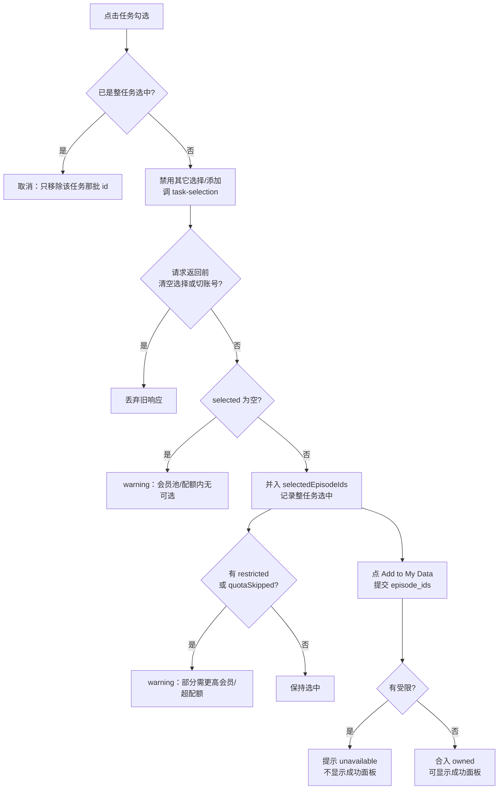

# Sprint 25：数据会员访问池（Membership Pool）与任务预览封顶

> 基于代码核对，最后更新 2026-10-06。结构：① commit → ② 业务逻辑 → ③ 测试分析 → ④ 用例 → ⑤ 发布检查 → ⑥ 待确认。

---

## 0. 一页纸摘要

| 项 | 内容 |
| --- | --- |
| 目标 | 按会员把可下载 episode 分成嵌套访问池（discover ⊂ researcher）；每任务公开预览封顶 48 条 |
| 受影响面 | Data Pipeline、Preview Worker、历史迁移、Cloud Build 开关、Marketing Browse / My Data |
| 三个开关 | `DATA_ACCESS_POOL_ENABLED`、`PREVIEW_TASK_POOL_ENABLED`、`PREVIEW_DELETE_RETIRED`（生产默认 `true`） |
| 核心规则 | ① tier 只约束**首次加入 My Data**；② Browse 预览 ≤48，各套餐相同；③ 整任务由 `task-selection` 按会员池+月配额计算；④ Add 提交显式 `episode_ids`；⑤ 浏览器下载只在 My Data，一次最多 10 条 |
| 前置条件 | 目标库先完成历史迁移并通过 verify，再开三个开关 |

---

## 1. 范围与 commit 清单

| # | 仓库 | Commit | 日期 | 主题 | 章节 |
| --- | --- | --- | --- | --- | --- |
| 1 | backend | `55d5c43` | 10-01 | 会员池模型、迁移、任务池 Worker | §2.3–2.9 |
| 2 | marketing | `3ff377a` | 10-01 | Browse 会员对接第一版（后被 #6 取代部分逻辑） | §2.9–2.10 |
| 3 | backend | `5d0a6f1` | 10-02 | 开关默认值与清理 rollout | §2.2、§2.5、§2.13 |
| 4 | backend | `7cc34e3` | 10-02 | catalog 计数 + `task-selection` | §2.10–2.11 |
| 5 | marketing | `2fa04ad` | 10-02 | Merge（无关） | 不测 |
| 6 | marketing | `2e62095` | 10-02 | 改用 `task-selection`、两阶段 count | §2.10–2.11 |
| 7 | marketing | `28de86f` | 10-02 | UI 修补 | §2.12 |
| 8 | marketing | `9907320` | 10-02 | Browse→My Data 跳转 | §2.12 |
| 9 | marketing | `b469bb5` | 10-02 | Merge（无关） | 不测 |
| 10 | marketing | `bc82180` | 10-06 | 计数按 episode，不再 ×4 | §2.11 |
| 11 | marketing | `15575b5` | 10-06 | 浏览器下载直连 GCS | §2.12 |

---

## 2. 业务逻辑

### 2.1 术语

| 术语 | 含义 |
| --- | --- |
| episode | 页面计数单位；不再 ×4 成 assets |
| 合格 episode | `DERIVED_READY` 且任务已发布 |
| `access_tier` | `discover` / `researcher` / `unallocated` / `NULL`。**只约束首次加入 My Data**。`NULL`=未分池；`unallocated`=已分池第三档 |
| 展示预览 | `status='READY' AND is_displayed=true`，每任务 ≤48。Browse 只读此标记，不现场重筛 |
| 池 | discover = tier discover；researcher = discover + researcher |
| 首次加入 My Data | 第一次写入 `data_user_library_episodes` |
| 月配额 | `monthly_episode_limit − 当月新增入库数` |

### 2.2 开关与部署映射

| 开关 | 缺省 / 生产 | 注入 | 作用 |
| --- | --- | --- | --- |
| `DATA_ACCESS_POOL_ENABLED` | `false` / `true` | Pipeline | Browse 只出已展示预览并按 `displayed_at` 排序；首次加入 My Data / `task-selection` 按 tier 过滤 |
| `PREVIEW_TASK_POOL_ENABLED` | `false` / `true` | Worker、Selection、Backfill | Worker 走任务池；legacy backfill 拒跑 |
| `PREVIEW_DELETE_RETIRED` | `false` / `true` | Worker、Selection | 轮换后删退役对象与 DB 行；关则只隐藏 |

### 2.3 数据模型

| 对象 | 含义 |
| --- | --- |
| `data_episodes.access_tier` | `discover` / `researcher` / `unallocated`，可空 |
| `data_preview_episodes` | preview episode 登记表：有没有预览、文件在哪、是否展示。会员池在 `access_tier`，不在这张表 |
| `is_displayed` | 是否挂在任务对外 ≤48 张卡上 |
| `displayed_at` | **第一次公开上架**的时刻。转码成功时写 `NOW()`（仅当时为空）；历史迁移用行的 `created_at`。退役保留，不改写；失败行保持空 |
| `selection_rank` | 本 upload 选中顺序，从 1 起。不是质量分，不决定 Browse 顺序；替换预览时不改已有 rank |
| `selection_version` | `task-pool-v1` / `historical-access-pool-v1`（旧：`upload-v1`） |
| `status` | `SELECTED` → `PROCESSING` → `READY` / `FAILED` |

```text
data_episodes            → 数据 + access_tier（谁能首次加入 My Data）
data_preview_episodes    → 预览样本：有没有、在哪、是否展示
data_preview_upload_jobs → 每个 upload 的预览进度 / selection_version
```

选片规则见 §2.6.1：选出后先插入本表，再转码、上架。

### 2.4 分池算法（`allocate_tiers`）

合格数 `N`、展示预览数 `P`：discover = `max(P, ceil(N/10))`；researcher 总量 = `max(discover, ceil(N/4))`；其余 unallocated。

展示预览先全部进 discover；其余按 `SHA256("{seed}:{episode_id}")` 升序补满。Seed：历史迁移用 `historical-access-pool-v1:{task_id}`；新 upload 用 `task-pool-v1:{upload_id}`；晚到用 `…:late`。只写 `access_tier IS NULL` 的行，老 unallocated 不重洗。

例：`N=100, P=8` → discover 10，researcher 总量 25，unallocated 75。

### 2.5 一次性历史迁移

`apply` 单事务：确认备份标记 → 加锁 → 已有 pool job / `PROCESSING` / 范围内 task 不一致则拒绝 → 写全部合格 episode 的 `access_tier` → 每任务最多保留 48 条 preview（优先 READY 跨 upload 均衡展示）→ 展示集必为 discover → 终态 upload 打上 `historical-access-pool-v1`。不删业务数据；桶对象不在此事务删。不可重复 apply。

### 2.6 新上传：选片、转码、上架

`PREVIEW_TASK_POOL_ENABLED=true` 时：先选片写入 `data_preview_episodes` → 按 `selection_rank` 转码 → 成功再 `_publish` 上架。只处理本 upload 里 `DERIVED_READY` 且 `access_tier` 为空的 episode（`NULL` ≠ `unallocated`）。已处理过的 upload，晚到 episode 只补会员档，不再选预览、不转码。

设未分配数 `N`，任务当前展示数 `S`。

#### 2.6.1 选哪些 episode

| 条件 | 选出条数 |
| --- | --- |
| `S < 48` | `min(48 − S, ceil(N / 20))` |
| `S = 48` 且 `N > 4` | 4（轮换） |
| `S = 48` 且 `N ≤ 4` | 0（只分会员池） |

**挑哪几条不看上传时间，也不看 `episode_id` 大小。对每个候选算 `SHA256("task-pool-v1:{upload_id}:{episode_id}")`，哈希升序，相同再按 `episode_id` 升序，取前若干条。同一 upload 再跑顺序不变。**

选出的写入预览表（`selection_rank` 从 1，此时未上架）；同一次给这批 `N` 条写 `access_tier`（预览先进 discover，再按哈希补池）。例：`S=48`、`N=100` → 选 4 条预览，约 discover 10 / researcher 总量 25 / unallocated 75。

#### 2.6.2 转码

对派生好的三路主摄像头（头顶 / 左 / 右）做缩短压缩，不碰 mcap。缺一路则整条 `FAILED`，不上架。ffmpeg：前 **30 秒**、高 **540**、左下角 **PrismaX** 水印、H.264 CRF **26**；输出 `cam_high/left/right.mp4` 到 `preview/{upload_id}/{episode_key}/540p-v2/`。`preview.jpg` 原样复制；目标已存在则跳过。三路成功才 `READY` 并写 `displayed_at`。

#### 2.6.3 上架与替换（`_publish`）

每成功一条：满 48 时按 `displayed_at` 最旧退役（`is_displayed=false`，`displayed_at` 保留）；新行 `discover` + `is_displayed=true` + `displayed_at=NOW()`，**不改** `selection_rank`。失败不退役别人。结束后若 `PREVIEW_DELETE_RETIRED=true` 走 §2.7。拿不到 upload/task 锁返回 `BUSY`。路径歧义、多 task、未迁移的旧 job：拒绝。

### 2.7 运行时退役清理（`cleanup_retired`）

清理当前任务内 `NOT is_displayed AND displayed_at IS NOT NULL` 的行：校验预览桶路径，共享前缀跳过，对象删完再删 DB 行。只处理运行时轮换退役；历史迁移删掉的行不在此清理。

### 2.8 Browse 与预览过滤

Browse 只读已展示预览（`READY` + `is_displayed`），不现挑。卡片顺序：`displayed_at` 新→旧，再 `upload_id` 大→小，再 `episode_id` 小→大。不是按 upload 上传时间；`selection_rank` 不参与。Discover / Researcher 看到同一套 ≤48 张卡；Researcher 只是可加入 My Data 的池更大。

开关打开时相关接口只返回已展示预览，并按 `displayed_at DESC`：`GET /data/downloadable-uploads`（含 `preview_displayed_at`）、`POST …/previews`、`GET …/preview-videos`（未展示 404）、`GET …/uploadable-task-preview/<task_id>`（封面取最新一条）。

### 2.9 首次加入 My Data 与会员准入

| 会员 | 可首次加入 |
| --- | --- |
| `discover` | discover |
| `researcher` | discover + researcher |
| `admin` / `test` / `enterprise` | 全部 |
| 其它 | 全部受限 |

开关关闭：不按 tier 过滤。已拥有不再查 tier；`NULL` / `unallocated` / 非 `DERIVED_READY` 对公开套餐受限；月配额只计允许写入的新增。

### 2.10 整任务选择：`POST /data/my-data/task-selection`

| 字段 | 含义 |
| --- | --- |
| `task_id` | 目标任务（必填） |
| `selected_episode_ids` | 当前已选（可跨任务） |
| `preview_episode_ids` | 当前预览卡 id；配额不够时谁先占槽 |

占配额顺序：预览卡优先 → 其余合格 episode → 组内 `episode_id` 升序。

**预览卡不按 `displayed_at`，也不按页面先后。后端只判断「是不是预览卡」，再按 `episode_id` 升序。配额只剩 1 时，选中预览卡里 `episode_id` 最小的那条，不是最新上架的那张。**

已拥有必选且不占配额；不符会员池的跳过。`slots = 剩余月配额 − |已选且未拥有|`。admin/test/enterprise 或开关关闭：不按 tier 过滤。

**前端流程（`handleToggleGroupSelection`）**



旁路：点单卡 / `✕` / 筛选隐藏 → 不再算整任务选中，其余 id 保留。预览外已选 episode 的 video 数按 ×3 估算。

### 2.11 Catalog 计数

前端把侧栏、任务卡、机器徽章、底部已选从 **assets（×4）改成直接显示 episode**。后端返回的本来就是 episode 数；旧页面数字约为现在的 4 倍，属预期。计数失败显示 `— episodes`，不影响预览。

### 2.12 Marketing 其余改动

| 点 | 行为 |
| --- | --- |
| Preview 到底 | 无 More 时提示还有更多数据可能在 membership，链到 `/account` |
| 文案清理 | 去掉 Assets / outside preview sample 摘要 |
| Browse → My Data | 全部成功且选择未变才出 `Open My Data to download`；预选刚加入的 id，清筛选 |
| 浏览器下载 | 仅 My Data，一次 ≤10；直连 GCS 签名链接，不再走 `/api/download-file` |

下载：先 `POST /data/downloads/ui`（`access_context=my_data`）拿签名 URL → 浏览器直拉 GCS。有目录选择则写入所选文件夹；否则普通下载。单条失败不影响已成功文件。Browse 入口：Browser / SDK / History。

### 2.13 上线顺序

1. 历史迁移已提交并通过 verify。
2. 部署 Pipeline + Marketing，`DATA_ACCESS_POOL_ENABLED=true`；GCS 签名允许浏览器跨域。
3. 部署 Worker + Selection Job，`PREVIEW_TASK_POOL_ENABLED=true`。
4. Backfill Scheduler 保持暂停。
5. 未准备好删桶时把 `PREVIEW_DELETE_RETIRED` 设为 `false`。

---

## 3. 测试分析

### 3.1 测试范围

| 类别 | 内容 |
| --- | --- |
| 必测 | 开关与部署；历史迁移核对；Browse 过滤/排序；首次加入 My Data；整任务选择；catalog 按 episode；补位/轮换；Browse→My Data；浏览器直连 GCS；桶清理 dry-run |
| 回归 | 开关关闭行为不变；admin/test/enterprise 与公司订单不受影响；已拥有数据仍可下载；`GET /data/tasks` 默认不加聚合；SDK 页创建 package 的现有流程 |
| 不测 | 营销站套餐入口（`Member.md`）；哈希排名与离线计划逐条比对；桶 versioning/soft-delete 的字节回收；`--apply` 删除只在维护窗口由运维执行，本轮只做 dry-run 与 fail-shut |

### 3.2 前置条件与环境

| 项 | 要求 |
| --- | --- |
| 版本 | Pipeline 含 `55d5c43`+`5d0a6f1`+`7cc34e3`；Worker 含 `55d5c43`+`5d0a6f1`；Marketing 含 `3ff377a`+`2e62095`+`28de86f`+`9907320`+`bc82180`+`15575b5` |
| 数据库 | 已执行历史迁移，verify SQL 每任务 `unprocessed_episodes=0` |
| 开关 | 准入/浏览用例：`DATA_ACCESS_POOL_ENABLED=true`；轮换用例：`PREVIEW_TASK_POOL_ENABLED=true`；隐藏不删与删除分别用 `PREVIEW_DELETE_RETIRED=false/true` 各跑一轮；开关关闭回归需要独立的未迁移环境 |
| 核对手段 | 抓接口响应 + 只读 SQL（`data_user_library_episodes`、`access_tier`、`is_displayed`、`displayed_at`、`selection_version`）；不要只看 toast |
| 触发处理 | 单条 upload 用 `POST /jobs/process-upload/<upload_id>`；不要对已标记历史 upload 跑旧 backfill |

### 3.3 测试数据

任务：

| 名称 | 条件 |
| --- | --- |
| 展示预览已满 48 条的任务 | 合格 episode ≥ 120；`is_displayed AND status='READY'` 的预览恰好 48 条 |
| 展示预览不足 48 条的任务 | 合格 episode ≥ 30；`is_displayed AND status='READY'` 的预览少于 48 条 |
| 未发布任务 | 已有 `DERIVED_READY` episode 但任务未发布 |

Episode（除“非 Ready episode”外，均在“展示预览已满 48 条的任务”或“展示预览不足 48 条的任务”内，状态为 `DERIVED_READY`）：

| 名称 | 条件 |
| --- | --- |
| Discover 已展示 episode | tier=discover，`is_displayed=true` |
| Discover 未展示 episode | tier=discover，未展示 |
| Researcher episode | tier=researcher，目标账号未拥有 |
| Unallocated episode | tier=unallocated，目标账号未拥有 |
| NULL tier episode | tier 为 NULL（模拟未迁移） |
| 已拥有的 Researcher episode | 目标账号 My Data 已有，tier=researcher |
| 已拥有的 Unallocated episode | 目标账号 My Data 已有，tier=unallocated |
| 非 Ready episode | 状态非 `DERIVED_READY` |

账号：Discover、Discover（剩余月配额=1）、Researcher、admin、test、enterprise、无有效数据会员、公司成员（有组织订单）。

### 3.4 风险矩阵

| ID | 风险 | 等级 | 验证方式 |
| --- | --- | --- | --- |
| R-01 | 未迁移就打开开关，公开套餐什么都加不进去 | 高 | CONFIG-004、MIGRATION-001 |
| R-02 | Pipeline 已开、Worker 仍旧模式，补出旧公式预览 | 高 | ROTATION-008 |
| R-03 | 下载/package 路径部分放行越权 episode | 高 | ACCESS-020 ~ ACCESS-023 |
| R-04 | 已拥有被新规则收回 | 高 | ACCESS-030 ~ ACCESS-032 |
| R-05 | 浏览泄露未展示/已退役预览 | 高 | BROWSE-001 ~ BROWSE-004 |
| R-06 | 单任务展示数超过 48 | 高 | MIGRATION-004、ROTATION-001 ~ ROTATION-004 |
| R-07 | 整任务选择只覆盖 48 张预览，或无视会员池/配额 | 高 | SELECTION-001 ~ SELECTION-008 |
| R-08 | 前端把受限当成全部成功；owned 误含受限 id | 高 | ACCESS-008、ACCESS-009 |
| R-09 | 月配额把受限条数也算进去 | 高 | ACCESS-005、ACCESS-010 |
| R-10 | 特殊套餐/公司订单被误伤 | 高 | ACCESS-006、ACCESS-024 |
| R-11 | Cloud Build 默认 true 落到未迁移环境 | 高 | CONFIG-004 |
| R-12 | 轮换误删/过早删对象，或存储失败后丢 DB 行 | 高 | ROTATION-009 ~ ROTATION-012 |
| R-13 | 转码失败污染当前展示集 | 中 | ROTATION-006 |
| R-14 | 迁移可重复执行导致重洗 | 高 | MIGRATION-005 |
| R-15 | legacy backfill / Scheduler 仍在运行 | 高 | CONFIG-005、CONFIG-006 |
| R-16 | 桶清理误删 live 对象 | 高 | CLEANUP-001 ~ CLEANUP-007 |
| R-17 | catalog 计数失败拖垮页面或口径错乱 | 高 | COUNT-003 ~ COUNT-005 |
| R-18 | Browse→My Data 预选丢失或过期缓存 | 高 | MYDATA-001 ~ MYDATA-003 |
| R-19 | 前端并发/竞态：整任务请求未返回就清空、换账号、再次点击 | 中 | SELECTION-016、SELECTION-017 |
| R-20 | 大任务整任务选择时响应与后续 `episode_ids` 请求体过大 | 中 | SELECTION-018 |
| R-21 | `GET /data/tasks` 默认路径多跑聚合 | 中 | COUNT-001 |
| R-22 | 选择量 > 10 时 My Data 无法浏览器下载，用户困惑 | 中 | MYDATA-004，另见 §6 Q3 |

### 3.5 已知实现口径（执行用例时按此判定，不要当缺陷）

1. `task-selection` 的 `slots` 扣减的是**所有**「已选且未拥有」的 id（包括其它任务、也包括本身可能受限的 id），所以会偏保守。
2. `pool_episode_count` 包含因配额被跳过的条数和已拥有的条数。
3. 已拥有的 episode 在 `task-selection` 中不占配额，也不受 tier 限制。
4. `task-selection` 不会因任务内 episode 被其它账号占用而变化；它只依赖 tier、拥有关系、配额。
5. 开关关闭时 `task-selection` 不按 tier 过滤，但仍扣配额。
6. 前端「整任务选中」被任意单卡操作打破后，该任务的其它 id 仍在选择中。

---

## 4. 测试用例

约定：

- 优先级：P0 必测 / P1 重要 / P2 补充。
- 「API」表示用接口直接验证；「UI」表示在 Beta 页面操作并抓包。
- ID 前缀对应模块：CONFIG 开关与部署、MIGRATION 历史迁移、BROWSE 浏览与预览、ACCESS 首次加入 My Data 与准入、SELECTION 整任务选择、COUNT Catalog 计数、ROTATION 补位轮换与退役、MYDATA Browse→My Data 与下载、CLEANUP 历史桶清理。

| ID | 模块 | 优先级 | 场景 | 前置条件 | 操作步骤 | 预期结果 |
| --- | --- | --- | --- | --- | --- | --- |
| CONFIG-001 | 开关与部署 | P0 | 生产默认值 | 已拿到当前分支代码 | 打开 `cloudbuild.yaml` 的 substitutions 部分，并运行 `app_prismax_preview_worker/test_pool_deploy_config.py` | `_DATA_ACCESS_POOL_ENABLED`、`_PREVIEW_TASK_POOL_ENABLED`、`_PREVIEW_DELETE_RETIRED` 三项默认值均为 `'true'`；单测通过 |
| CONFIG-002 | 开关与部署 | P0 | 各服务注入的开关对照 | 已拿到当前分支的 `cloudbuild.yaml`（Pipeline、Worker、Selection Job、Backfill Job 的 deploy step） | 逐个打开这四个 deploy step，查看注入的环境变量 | Pipeline 仅 `DATA_ACCESS_POOL_ENABLED`；Worker/Selection Job 含 `PREVIEW_TASK_POOL_ENABLED`+`PREVIEW_DELETE_RETIRED`；Backfill Job 仅 `PREVIEW_TASK_POOL_ENABLED`；全部为 `--update-env-vars` |
| CONFIG-003 | 开关与部署 | P1 | 部署后实际 env | 已完成一次部署 | 查 Cloud Run 服务与 Job 的 env | Pipeline 仅有 `DATA_ACCESS_POOL_ENABLED`；Worker 与 Selection Job 含 `PREVIEW_TASK_POOL_ENABLED` 和 `PREVIEW_DELETE_RETIRED`；Backfill Job 仅有 `PREVIEW_TASK_POOL_ENABLED`；部署前已存在的其它 env 仍在 |
| CONFIG-004 | 开关与部署 | P0 | 未迁移环境覆盖 | 存在尚未执行历史迁移的环境 | 查看该环境对应 Cloud Build 触发器的 substitutions 覆盖 | 三个开关均被覆盖为 `false`，或该环境的部署被阻止 |
| CONFIG-005 | 开关与部署 | P0 | legacy backfill 拒跑 | `PREVIEW_TASK_POOL_ENABLED=true` | 手动执行 Backfill Job（`python task_preview_backfill.py`） | 在访问 DB 和存储前就抛 `Legacy preview backfill is disabled in task-pool mode` |
| CONFIG-006 | 开关与部署 | P1 | Backfill Scheduler 保持暂停 | 池模式已开启，Backfill Job（`app-prismax-preview-task-backfill`）已部署 | 在 Cloud Scheduler 查看该 Job 对应的触发器 | 触发器处于暂停状态 |
| MIGRATION-001 | 历史迁移 | P0 | verify SQL | 历史迁移已提交（Beta/Prod 不重新 apply，只核对结果） | 在 Cloud SQL Studio 选中应用库，运行 `20261001_cloud_sql_history_verify.sql` | 每个任务 `unprocessed_episodes=0`；`displayed_previews ≤ 48` |
| MIGRATION-002 | 历史迁移 | P0 | 池大小 | 历史迁移已提交（Beta/Prod 不重新 apply，只核对结果） | 对任意一个任务，按 §2.4 公式核算该任务 discover / researcher 的 episode 数量 | `discover ≥ max(展示数, ceil(N/10))`；`researcher_total ≥ max(discover, ceil(N/4))` |
| MIGRATION-003 | 历史迁移 | P0 | 展示集合法 | 历史迁移已提交（Beta/Prod 不重新 apply，只核对结果） | 用 SQL 抽查所有 `is_displayed=true` 的预览行 | 这些行的 `status` 均为 `READY`，对应 episode 的 `access_tier` 均为 discover |
| MIGRATION-004 | 历史迁移 | P0 | 每任务封顶 | 历史迁移已提交（Beta/Prod 不重新 apply，只核对结果） | 用 SQL 按任务统计 `is_displayed AND status='READY'` 的预览行数 | 每个任务均 ≤ 48 |
| MIGRATION-005 | 历史迁移 | P0 | 不能重复迁移 | 非生产库，已初始化 | 再次 apply（确认值 `yes`） | 因已存在 pool marker 被拒绝；tier 与预览行不变 |
| MIGRATION-006 | 历史迁移 | P0 | 用户数据不丢 | 有迁移前导出 | 对比迁移前后 | episode、个人库、用户、会员、订单行数不变 |
| MIGRATION-007 | 历史迁移 | P1 | 历史终态 upload 有标记 | 迁移已提交 | 查 `data_preview_upload_jobs.selection_version` | 终态 upload 均有 `historical-access-pool-v1`，包括零预览的 |
| MIGRATION-008 | 历史迁移 | P1 | 未完成/失败 episode 不挡迁移 | 非生产库，构造 task 不一致数据 | 对照 `5d0a6f1` 的条件执行 apply 前检查 | task 不一致但无 preview 且未完成的数据不触发拒绝；迁移范围内不一致则拒绝 |
| BROWSE-001 | 浏览与预览 | P0 | 列表只含已展示 | `DATA_ACCESS_POOL_ENABLED=true`；库已完成历史迁移 | Discover 账号打开 Browse，展开一个“展示预览已满 48 条的任务” | 卡片全部来自 `is_displayed=true` 的 READY 预览；未展示的预览没有入口 |
| BROWSE-002 | 浏览与预览 | P0 | 预览视频接口 | `DATA_ACCESS_POOL_ENABLED=true`；库已完成历史迁移；先用 SQL 取一个未展示的 episode：`SELECT pe.episode_id FROM data_preview_episodes pe JOIN data_episodes e USING (episode_id) WHERE pe.status='READY' AND NOT pe.is_displayed AND e.status='DERIVED_READY' LIMIT 1;` | `curl -i "https://beta-www.prismax.ai/prismax-data/data/downloadable-episodes/<未展示的episode_id>/preview-videos?public=1"`（`<…>` 换成上一步查到的 id） | HTTP 404，body 为 `{"success": false, "msg": "episode not found"}`，无任何视频 URL。对照：把 id 换成一个已展示的 episode，返回 200 且 `data.derived_videos` 非空 |
| BROWSE-003 | 浏览与预览 | P0 | 前端预览批量接口 | `DATA_ACCESS_POOL_ENABLED=true`；库已完成历史迁移；已取得一个已展示和一个未展示的 episode_id | `curl -i -X POST "https://beta-www.prismax.ai/prismax-data/data/downloadable-uploads/previews?public=1" -H "Content-Type: application/json" -d '{"selected_episode_ids": [<已展示的id>, <未展示的id>]}'` | HTTP 200；`data` 数组只含已展示的那个 episode_id，不含未展示的 |
| BROWSE-004 | 浏览与预览 | P0 | 任务封面 | `DATA_ACCESS_POOL_ENABLED=true`；库已完成历史迁移；某任务有多条已展示预览，`displayed_at` 各不相同 | `curl -i "https://beta-www.prismax.ai/prismax-data/data/tasks/uploadable-task-preview/<task_id>"`；再用 SQL 查该任务 `is_displayed AND status='READY'` 且 `displayed_at` 最大的 episode_id | HTTP 200；`data.episode_id` 等于 SQL 查到的 episode_id；`data.videos` 非空。对照：任务没有任何已展示预览时返回 200 且 `videos` 为空数组 |
| BROWSE-005 | 浏览与预览 | P0 | 排序 | `DATA_ACCESS_POOL_ENABLED=true`；库已完成历史迁移；同一任务下有多条已展示预览，`displayed_at` 各不相同 | 请求 `GET https://beta-www.prismax.ai/prismax-data/data/downloadable-uploads` 并查看该任务的 episode 顺序；在 Browse 页面展开该任务看卡片顺序 | 响应每条含 `preview_displayed_at`；接口与页面的顺序均按该字段从新到旧 |
| BROWSE-006 | 浏览与预览 | P0 | 套餐无关 | `DATA_ACCESS_POOL_ENABLED=true`；库已完成历史迁移；准备一个 Discover 账号和一个 Researcher 账号 | 两个账号分别打开同一个“展示预览已满 48 条的任务” | 两个账号看到的预览集合、数量、顺序一致，且数量均 ≤ 48 |
| BROWSE-007 | 浏览与预览 | P1 | 未分配不占预览 | `DATA_ACCESS_POOL_ENABLED=true`；库已完成历史迁移；该任务内存在 tier 为 unallocated 或 NULL 且未展示的 episode | 打开 Browse，展开“展示预览已满 48 条的任务” | tier 为 unallocated 或 NULL 且未展示的 episode 不出现在卡片中 |
| BROWSE-008 | 浏览与预览 | P0 | 开关关闭回归 | 独立的未迁移环境，`DATA_ACCESS_POOL_ENABLED=false`；存在 `is_displayed=false` 的 READY 预览 | `curl -i "https://beta-www.prismax.ai/prismax-data/data/downloadable-episodes/<未展示的episode_id>/preview-videos?public=1"` | HTTP 200，仍返回视频 URL（开关关闭时查询不加 `is_displayed` 条件）；列表也不强制按 `displayed_at` 排序 |
| ACCESS-001 | 首次加入 My Data 与准入 | P0 | Discover 加 discover | `DATA_ACCESS_POOL_ENABLED=true`；Discover 会员账号，尚未拥有被测 episode，当月月配额充足 | 调 `POST /data/my-data`，`episode_ids` 只含一个 Discover 已展示 episode | HTTP 200；`added_episode_count=1`；个人库多出该 episode；当月用量 +1 |
| ACCESS-002 | 首次加入 My Data 与准入 | P0 | Discover 加 researcher | `DATA_ACCESS_POOL_ENABLED=true`；Discover 会员账号，尚未拥有被测 episode，当月月配额充足 | 调 `POST /data/my-data`，`episode_ids` 只含一个 Researcher episode | HTTP 200；`added_episode_count=0`；`restricted_episode_ids` 含该 Researcher episode；个人库与当月用量均不变 |
| ACCESS-003 | 首次加入 My Data 与准入 | P0 | Discover 加 unallocated | `DATA_ACCESS_POOL_ENABLED=true`；Discover 会员账号，尚未拥有被测 episode，当月月配额充足 | 调 `POST /data/my-data`，`episode_ids` 只含一个 Unallocated episode | HTTP 200；`added_episode_count=0`；`restricted_episode_ids` 含该 Unallocated episode；个人库与当月用量均不变 |
| ACCESS-004 | 首次加入 My Data 与准入 | P0 | Discover 加 NULL tier | `DATA_ACCESS_POOL_ENABLED=true`；Discover 会员账号，尚未拥有被测 episode，当月月配额充足 | 调 `POST /data/my-data`，`episode_ids` 只含一个 NULL tier episode | HTTP 200；`added_episode_count=0`；`restricted_episode_ids` 含该 NULL tier episode；个人库与当月用量均不变 |
| ACCESS-005 | 首次加入 My Data 与准入 | P0 | 混合选择 | `DATA_ACCESS_POOL_ENABLED=true`；Discover 会员账号，尚未拥有被测 episode，当月月配额充足 | 调 `POST /data/my-data`，`episode_ids` 含 Discover 已展示 episode、Researcher episode、Unallocated episode 各一个 | 只新增 Discover 已展示 episode；`restricted_episode_count=2`；`quota.new_episodes=1` |
| ACCESS-006 | 首次加入 My Data 与准入 | P0 | 特殊套餐不看 tier | `DATA_ACCESS_POOL_ENABLED=true`；分别准备 admin、test、enterprise 三类账号，各自尚未拥有被测 episode，当月月配额充足 | 每个账号分别调 `POST /data/my-data`，`episode_ids` 含 Discover 已展示 episode、Researcher episode、Unallocated episode 各一个 | 每个账号三条全部新增；`restricted_episode_count=0` |
| ACCESS-007 | 首次加入 My Data 与准入 | P0 | Researcher 两级池 | `DATA_ACCESS_POOL_ENABLED=true`；Researcher 会员账号，尚未拥有被测 episode，当月月配额充足 | 调 `POST /data/my-data`，`episode_ids` 含 Discover 已展示 episode、Researcher episode、Unallocated episode 各一个 | 新增 Discover 已展示 episode 和 Researcher episode 两条；仅 Unallocated episode 受限；当月用量 +2 |
| ACCESS-008 | 首次加入 My Data 与准入 | P0 | UI toast（部分受限） | `DATA_ACCESS_POOL_ENABLED=true`；Discover 会员账号，尚未拥有被测 episode，当月月配额充足 | 在 Browse 页面选中 Discover 已展示 episode、Researcher episode、Unallocated episode 各一个，点 Add to My Data，抓取 `/data/my-data` 响应并观察 toast | toast 含 `1 episode added to My Data` 与 `2 unavailable with your current membership`；owned 列表只增加 Discover 已展示 episode；成功面板不显示（因为有受限） |
| ACCESS-009 | 首次加入 My Data 与准入 | P0 | UI toast（全部受限） | `DATA_ACCESS_POOL_ENABLED=true`；Discover 会员账号，尚未拥有被测 episode，当月月配额充足 | 在 Browse 页面只选中一个 Researcher episode，点 Add to My Data | toast 类型为 warning，文案含 `unavailable with your current membership`；owned 列表不增加；成功面板与「Open My Data to download」均不出现 |
| ACCESS-010 | 首次加入 My Data 与准入 | P0 | check 与 add 一致 | `DATA_ACCESS_POOL_ENABLED=true`；Discover 会员账号，尚未拥有被测 episode，当月月配额充足 | 用同一组 `episode_ids`（Discover 已展示 episode、Researcher episode、Unallocated episode 各一个）先调 `POST /data/my-data/check`，再调 `POST /data/my-data` | 两次返回的 `new_episode_ids`（add 为 `added_episode_ids`）、`restricted_episode_ids`、`projected_episodes` 一致；`check` 不写库 |
| ACCESS-011 | 首次加入 My Data 与准入 | P1 | 非公开套餐 | `DATA_ACCESS_POOL_ENABLED=true`；账号的数据会员计划有效，但计划名不是 discover、researcher、admin、test、enterprise 中的任何一个（例如自定义套餐） | 调 `POST /data/my-data`，`episode_ids` 含一个 Discover 已展示 episode | HTTP 200；`added_episode_count=0`；`restricted_episode_ids` 含该 episode；个人库不变 |
| ACCESS-012 | 首次加入 My Data 与准入 | P1 | 无有效数据会员 | 账号没有有效的数据会员计划 | 调 `POST /data/my-data`，`episode_ids` 含一个 Discover 已展示 episode | 被现有会员校验拒绝（非 200 成功响应）；个人库不变 |
| ACCESS-013 | 首次加入 My Data 与准入 | P1 | 超出月配额 | Discover 会员账号，当月剩余月配额=1；尚未拥有 2 个 Discover 已展示 episode | 调 `POST /data/my-data`，`episode_ids` 含这 2 个 episode | HTTP 402；响应 `data` 含配额信息（`monthly_episode_limit`、`used_episodes`、`projected_episodes` 等）；个人库不变 |
| ACCESS-020 | 首次加入 My Data 与准入 | P0 | 非 My Data 下载越权 | `DATA_ACCESS_POOL_ENABLED=true`；Discover 会员账号，尚未拥有被测 episode，当月月配额充足 | 调 `POST /data/downloads/ui`（body 不带 `access_context=my_data`），`selected_episode_ids` 只含一个 Researcher episode | HTTP 403，msg 为 `Some selected episodes are not available with your membership.`；个人库不变；响应里没有下载 URL |
| ACCESS-021 | 首次加入 My Data 与准入 | P0 | 混合整单拒绝 | `DATA_ACCESS_POOL_ENABLED=true`；Discover 会员账号，尚未拥有被测 episode，当月月配额充足 | `POST /data/downloads/ui`（不带 `access_context=my_data`），`selected_episode_ids` 含一个 Discover 已展示 episode 和一个 Researcher episode | HTTP 403；两条都不入库；当月用量不变 |
| ACCESS-022 | 首次加入 My Data 与准入 | P0 | SDK package 越权 | `DATA_ACCESS_POOL_ENABLED=true`；Discover 会员账号，尚未拥有被测 episode，当月月配额充足 | UI：在 SDK 页选中含 Researcher episode 的集合并创建 package；或 API：`POST /data/api-packages`，`selected_episode_ids` 含 Researcher episode | 创建失败；没有新的 ACTIVE package；个人库无变化 |
| ACCESS-023 | 首次加入 My Data 与准入 | P1 | 允许的 package | `DATA_ACCESS_POOL_ENABLED=true`；Discover 会员账号，尚未拥有被测 episode，当月月配额充足 | `POST /data/api-packages`，`selected_episode_ids` 只含一个 Discover 已展示 episode | package 创建成功，仅关联该 episode |
| ACCESS-024 | 首次加入 My Data 与准入 | P0 | 公司订单 | 账号是某公司组织成员；该组织订单内含一个 tier 为 unallocated 的 episode | 用该账号在 My Data 的订单来源下下载这个 episode | 可以下载，不因 tier 被拒绝（403） |
| ACCESS-030 | 首次加入 My Data 与准入 | P0 | 重复添加高 tier | `DATA_ACCESS_POOL_ENABLED=true`；Discover 会员账号已拥有“已拥有的 Researcher episode” | 调 `POST /data/my-data`，`episode_ids` 含该 episode | HTTP 200；`already_owned_episode_count=1`；`restricted_episode_count=0`；个人库行数与当月用量均不变 |
| ACCESS-031 | 首次加入 My Data 与准入 | P0 | My Data 下载已拥有的越权 tier | `DATA_ACCESS_POOL_ENABLED=true`；Discover 会员账号已拥有“已拥有的 Researcher episode” | `POST /data/downloads/ui`，body 带 `access_context=my_data` 和该 episode 的 id | 下载成功；不因 membership 返回 403；不扣月配额 |
| ACCESS-032 | 首次加入 My Data 与准入 | P1 | check 不重复计费 | `DATA_ACCESS_POOL_ENABLED=true`；Discover 会员账号已拥有“已拥有的 Researcher episode”，尚未拥有 Discover 已展示 episode | `POST /data/my-data/check`，`episode_ids` 含这两条 | `owned_episode_ids` 含已拥有的 Researcher episode；`new_episode_ids` 含 Discover 已展示 episode；`quota.new_episodes=1` |
| ACCESS-040 | 首次加入 My Data 与准入 | P0 | `task_ids` 展开全量合格（仅 API，当前前端不再使用） | `DATA_ACCESS_POOL_ENABLED=true`；Discover 会员账号，尚未拥有被测任务下的 episode；被测任务是一个“展示预览已满 48 条的任务” | `POST https://beta-www.prismax.ai/prismax-data/data/my-data/check`，header 带 `Authorization: Bearer <token>`，body `{"task_ids": [<该任务 id>], "episode_ids": [<该任务内一个 Discover 已展示 episode 的 id>]}` | `new_episode_ids` 覆盖该任务下全部 tier 为 discover 的合格 episode（数量远大于 48）；researcher 与 unallocated 的 episode 出现在 `restricted_episode_ids` 中 |
| ACCESS-041 | 首次加入 My Data 与准入 | P0 | `task_ids` 下 add 与 check 一致 | `DATA_ACCESS_POOL_ENABLED=true`；Discover 会员账号，尚未拥有被测任务下的 episode，月配额充足 | 先调 `POST /data/my-data/check`，body `{"task_ids": [<任务 id>], "episode_ids": [<任务内一个 Discover 已展示 episode 的 id>]}` 并记录结果；再用完全相同的 body 调 `POST /data/my-data` | add 只新增 check 返回的 `new_episode_ids` 中的 episode；`restricted_episode_ids` 与 check 相同；当月用量增加数 = 新增条数 |
| ACCESS-042 | 首次加入 My Data 与准入 | P1 | `task_ids` 指向未发布任务 | `DATA_ACCESS_POOL_ENABLED=true`；Discover 会员账号；存在一个未发布但有 `DERIVED_READY` episode 的任务 | `POST /data/my-data/check`，`task_ids` 只含该未发布任务 id，`episode_ids` 含一个 Discover 已展示 episode | 未发布任务下的 episode 不被展开，不出现在 `new_episode_ids` 或 `restricted_episode_ids` 中 |
| ACCESS-043 | 首次加入 My Data 与准入 | P1 | `task_ids` 开关关闭 | 独立的未迁移环境，`DATA_ACCESS_POOL_ENABLED=false`；Discover 会员账号 | `POST https://beta-www.prismax.ai/prismax-data/data/my-data/check`，header 带 `Authorization: Bearer <token>`，body `{"task_ids": [<任务 id>], "episode_ids": [<一个 episode 的 id>]}` | `task_ids` 被忽略；`new_episode_ids` 只含显式提交的那一个 episode |
| ACCESS-044 | 首次加入 My Data 与准入 | P2 | `task_ids` 超大任务 | `DATA_ACCESS_POOL_ENABLED=true`；Discover 会员账号；被测任务合格 episode 数很大（数千以上） | `POST /data/my-data/check`，`task_ids` 含该任务 id | 响应成功；记录耗时（`check` 的 owned 查询仍是 `IN` 列表），超时则登记性能问题 |
| SELECTION-001 | 整任务选择 | P0 | API：Discover + 配额 1 | Discover 会员账号，当月剩余月配额=1；任务内含 discover、researcher、unallocated 三种 tier 的未拥有 episode，另有 1 条该账号已拥有的 episode，其中 discover episode 至少 2 条 | `POST https://beta-www.prismax.ai/prismax-data/data/my-data/task-selection`，header 带 `Authorization: Bearer <token>`，body `{"task_id": <任务 id>}` | `selected_episode_ids` = 已拥有的 1 条 + 1 条 discover；`restricted_episode_count` = researcher 与 unallocated 的条数之和；`quota_skipped_episode_count` ≥ 1 |
| SELECTION-002 | 整任务选择 | P0 | API：Researcher | Researcher 会员账号，剩余月配额充足；任务内含 discover、researcher、unallocated 三种 tier 的未拥有 episode，另有 1 条该账号已拥有的 episode | `POST https://beta-www.prismax.ai/prismax-data/data/my-data/task-selection`，header 带 `Authorization: Bearer <token>`，body `{"task_id": <任务 id>}` | `selected_episode_ids` 含 discover、researcher 和已拥有的 episode；`restricted_episode_count` 等于 unallocated 的条数 |
| SELECTION-003 | 整任务选择 | P0 | API：特殊套餐 | admin、test、enterprise 账号各一个，剩余月配额充足；任务内含 discover、researcher、unallocated 三种 tier 的未拥有 episode，另有 1 条该账号已拥有的 episode | `POST https://beta-www.prismax.ai/prismax-data/data/my-data/task-selection`，header 带 `Authorization: Bearer <token>`，body `{"task_id": <任务 id>}` | `restricted_episode_count=0`；`selected_episode_ids` 含 unallocated episode |
| SELECTION-004 | 整任务选择 | P0 | API：已选占槽 | Discover 会员账号，当月剩余月配额=2；任务内至少有 3 条未拥有的 discover episode；用户已选中一个未拥有的 episode A | `POST https://beta-www.prismax.ai/prismax-data/data/my-data/task-selection`，header 带 `Authorization: Bearer <token>`，body `{"task_id": <任务 id>, "selected_episode_ids": [<A 的 id>]}` | 本任务最多再新增 1 条未拥有的 discover episode（剩余配额 2 − 已选 1）；其余计入 `quota_skipped_episode_count`；若 A 属于本任务，A 也在 `selected_episode_ids` 中 |
| SELECTION-005 | 整任务选择 | P1 | API：已选已拥有不占槽 | Discover 会员账号，剩余月配额 1；已选的 episode 全部是该账号已拥有的 | `POST /data/my-data/task-selection`，`selected_episode_ids` 全为已拥有的 episode | 已选项不扣减可用槽位；任务内仍可再选入 1 条未拥有的 discover episode |
| SELECTION-006 | 整任务选择 | P1 | API：预览优先 | Discover 会员账号，当月剩余月配额=1；任务内有 2 条未拥有的 discover episode：id 较小的 X 和 id 较大的 Y | `POST https://beta-www.prismax.ai/prismax-data/data/my-data/task-selection`，header 带 `Authorization: Bearer <token>`，body `{"task_id": <任务 id>, "preview_episode_ids": [<Y 的 id>]}` | `selected_episode_ids` 含 Y，不含 X（预览 id 优先占用槽位） |
| SELECTION-007 | 整任务选择 | P1 | API：开关关闭 | `DATA_ACCESS_POOL_ENABLED=false`；Discover 会员账号，当月剩余月配额=2；任务内含 discover、researcher、unallocated 的未拥有 episode 各若干 | `POST https://beta-www.prismax.ai/prismax-data/data/my-data/task-selection`，header 带 `Authorization: Bearer <token>`，body `{"task_id": <任务 id>}` | 不按 tier 过滤（`restricted_episode_count=0`）；新选入的未拥有 episode 最多 2 条，其余计入 `quota_skipped_episode_count` |
| SELECTION-008 | 整任务选择 | P1 | API：未发布任务 | Discover 会员账号；存在一个未发布、但有 `DERIVED_READY` episode 的任务 | `POST https://beta-www.prismax.ai/prismax-data/data/my-data/task-selection`，header 带 `Authorization: Bearer <token>`，body `{"task_id": <该未发布任务 id>}` | HTTP 200；`selected_episode_ids=[]`；`pool_episode_count=0` |
| SELECTION-009 | 整任务选择 | P1 | API：参数校验 | Discover 会员账号 | 分别调 `POST https://beta-www.prismax.ai/prismax-data/data/my-data/task-selection`：① body 缺 `task_id`；② `task_id` 为非数字字符串；③ `selected_episode_ids` 含非数字值 | 三种情况均返回 HTTP 400，`success=false` |
| SELECTION-010 | 整任务选择 | P0 | UI：整任务选中 | Discover 会员账号，剩余月配额充足；被测任务是一个“展示预览已满 48 条的任务”，合格 episode 数大于 48 | 在 Browse 页面勾选该任务，并用开发者工具查看 `task-selection` 请求 | 发出 `task-selection` 请求，body 含 `selected_episode_ids` 与 `preview_episode_ids`；页面选中数包含预览之外的 episode；选中的 episode 受会员池和剩余月配额限制 |
| SELECTION-011 | 整任务选择 | P0 | UI：提示文案 | Discover 会员账号；剩余月配额小于任务内未拥有 discover episode 数；任务内同时存在 researcher 或 unallocated episode | 在 Browse 页面勾选该任务 | 出现 warning toast，形如 `N task episodes selected; X episodes require a higher membership; Y exceed your remaining monthly quota.`，同时列出受限与超配额两项 |
| SELECTION-012 | 整任务选择 | P0 | UI：全不可选 | Discover 会员账号，当月剩余月配额=0（或任务内没有该账号可获取的 episode） | 在 Browse 页面勾选该任务 | warning toast：`No task episodes are available within your membership and remaining monthly quota.`；任务不被标记为整任务选中 |
| SELECTION-013 | 整任务选择 | P0 | UI：提交 body | Discover 会员账号已在 Browse 勾选一个任务，页面选中数大于 0 | 点 Add to My Data，用开发者工具查看 `/data/my-data` 的请求体 | 请求体为 `{"episode_ids": [...]}`，**不含** `task_ids`；`episode_ids` 与页面选中的 episode 一致 |
| SELECTION-014 | 整任务选择 | P1 | UI：取消整任务 | Browse 中已整任务选中任务 A 和任务 B | 再次点击任务 A 的勾选框 | 任务 A 那一批 episode 从选择中移除；任务 B 的选择保持不变 |
| SELECTION-015 | 整任务选择 | P1 | UI：单卡取消 | Browse 中已整任务选中任务 A | 取消任务 A 中某一张卡片的选中 | 任务 A 的其余 episode 仍保留在选择中；任务 A 不再显示为整任务选中 |
| SELECTION-016 | 整任务选择 | P1 | UI：选择中的互斥 | Discover 会员账号；`task-selection` 请求已发出但响应未返回（可用开发者工具限速模拟） | 尝试点击其它任务的勾选框、Add to My Data、移除已选项、创建 SDK package | 相关按钮处于禁用状态，不会发出第二个请求 |
| SELECTION-017 | 整任务选择 | P1 | UI：竞态 | Discover 会员账号；`task-selection` 请求已发出但响应尚未返回（可用浏览器开发者工具限速模拟） | 在响应返回前清空选择，或切换到另一个账号 | 旧响应被丢弃，选择保持为空 |
| SELECTION-018 | 整任务选择 | P2 | UI：大任务 | Discover 会员账号，月配额充足；被测任务合格 episode 数达数千以上 | 在 Browse 勾选该任务，再点 Add to My Data | `task-selection` 与 `/data/my-data` 请求均成功；页面不卡死。记录两次请求的响应体大小与耗时 |
| SELECTION-019 | 整任务选择 | P2 | UI：视频数估算 | Browse 中已整任务选中，选中项包含预览之外的 episode | 查看 Browse 底部的 video 统计 | video 数 = 预览内已选 episode 的真实 mp4 数 + 预览外已选 episode 条数 × 3 |
| COUNT-001 | Catalog 计数 | P0 | 默认不聚合 | Data Pipeline 含 `7cc34e3` | `curl -i "https://beta-www.prismax.ai/prismax-data/data/tasks"` | HTTP 200；响应的每个 task 都没有 `catalog_episode_counts` 字段；服务端只执行一次任务列表查询 |
| COUNT-002 | Catalog 计数 | P0 | opt-in 聚合 | Data Pipeline 含 `7cc34e3` | `curl -i "https://beta-www.prismax.ai/prismax-data/data/tasks?catalog_episode_counts=1"`；对任一任务再用 SQL 手算：`SELECT u.machine_id, COUNT(*) FROM data_episodes e JOIN data_uploads u ON u.upload_id=e.upload_id WHERE e.task_id=<任务 id> AND e.status='DERIVED_READY' GROUP BY u.machine_id;` | HTTP 200；每个 task 都有 `catalog_episode_counts`，元素含 `machine_id`、`product_name`、`episode_count`；各机器的 `episode_count` 与 SQL 手算结果一致 |
| COUNT-003 | Catalog 计数 | P0 | 两阶段加载 | Marketing 含 `2e62095` | 打开 Browse，用开发者工具 Network 观察请求先后顺序和页面计数文案 | 先请求 `/data/tasks` 与预览，页面立即可用；随后发出 `/data/tasks?catalog_episode_counts=1`；计数文案先显示 `…`，请求完成后变为数字 |
| COUNT-004 | Catalog 计数 | P0 | 页面等于 episode 数 | 已用 `GET /data/tasks?catalog_episode_counts=1` 取得某任务某机器的 `episode_count`（记为 C） | 在 Browse 页面查看该任务、该机器、侧栏和任务卡 | 四处都显示 C episodes，不是 `C × 4`，也没有 assets 单位 |
| COUNT-005 | Catalog 计数 | P0 | 计数失败降级 | 可用浏览器开发者工具拦截请求 | 拦截并使 `GET /data/tasks?catalog_episode_counts=1` 失败（Block request URL），然后刷新 Browse | toast：`Episode counts are unavailable. Previews are still ready; refresh to retry.`；计数位显示 `— episodes`；预览、选择、添加仍可用；取消拦截并刷新后恢复数字 |
| COUNT-006 | Catalog 计数 | P1 | 缺 task 计数 | 可改写响应（如用抓包代理） | 让 `GET /data/tasks?catalog_episode_counts=1` 的返回体缺少某个 task 的 `catalog_episode_counts` | 前端按计数失败处理：toast `Episode counts are unavailable. Previews are still ready; refresh to retry.`；计数显示 `— episodes`；预览、选择、添加仍可用 |
| COUNT-007 | Catalog 计数 | P1 | 详情弹窗 | Browse 已加载预览；该任务 catalog episode 数为 N | 点开任意一个 episode 的详情弹窗 | 副标题为 `N episodes in dataset`；统计块为 Scenario episodes、Preview avg quality、Preview episodes in batch、Preview avg duration。场景数等于该任务当前筛选下的 episode 数，不是 ×4 |
| COUNT-008 | Catalog 计数 | P1 | 机器筛选联动 | Browse 已加载且计数已显示 | 在机器筛选里勾选或取消某台机器 | 各任务及分类的 episode 数只按当前勾选的机器重新累计 |
| COUNT-011 | Catalog 计数 | P0 | 已选配额不乘 4 | 月额度为 Q，在 Browse 选中 K 条 episode | 看底部 Episodes 统计 | 标签是 Episodes；值为 `K / Q`。K=1 时显示 1，分母不是 4Q |
| COUNT-009 | Catalog 计数 | P1 | 空状态 | Browse 已加载 | 在机器筛选里取消全部机器 | 列表区提示 `Select at least one robot arm to view episodes.` |
| COUNT-010 | Catalog 计数 | P1 | 自动化 | 已拉取 backend 与 marketing 代码 | 在 marketing 仓库运行 `node --test tests/*.test.mjs`（含 `tests/roboticDataRules.test.mjs`）；在 backend 仓库运行 `app_prismax_data_pipeline/test_catalog_episode_counts.py` | 全部通过 |
| ROTATION-001 | 补位轮换与退役 | P0 | 未满补位 | `PREVIEW_TASK_POOL_ENABLED=true`；一个“展示预览不足 48 条的任务”，当前展示数 `S=40`；新 upload 有 `N=100` 条未分配 episode（`S`、`N` 含义见 §2.6） | 调 Preview Worker 的 `POST /jobs/process-upload/<upload_id>`（服务不允许匿名，header 带 `Authorization: Bearer $(gcloud auth print-identity-token)`） | 新增展示 `min(8, 5)=5` 条；新预览的 tier 为 discover；任务展示总数变为 45 |
| ROTATION-002 | 补位轮换与退役 | P0 | 已满轮换 4 条 | `PREVIEW_TASK_POOL_ENABLED=true`；一个“展示预览已满 48 条的任务”，当前展示数 `S=48`；新 upload 的未分配 episode 数 `N>4` | 调 Preview Worker 的 `POST /jobs/process-upload/<upload_id>`（服务不允许匿名，header 带 `Authorization: Bearer $(gcloud auth print-identity-token)`） | 4 条展示时间最旧的预览 `is_displayed=false`，`displayed_at` 仍保留；新增 4 条展示（tier 为 discover）；任务展示总数仍为 48 |
| ROTATION-003 | 补位轮换与退役 | P0 | 公开列表即时反映 | 一个“展示预览已满 48 条的任务”刚完成一次轮换（新上架 4 条，退役 4 条） | 刷新 Browse，展开该任务 | 卡片中出现新上架的 4 条；被退役的 4 条没有预览入口；卡片总数 ≤ 48 |
| ROTATION-004 | 补位轮换与退役 | P1 | 展示预览已满 48 条，且 upload 未分配 episode ≤ 4 | `PREVIEW_TASK_POOL_ENABLED=true`；一个“展示预览已满 48 条的任务”，`S=48`；新 upload 的未分配 episode 数 `N≤4`（`S`、`N` 含义见 §2.6） | 调 Preview Worker 的 `POST /jobs/process-upload/<upload_id>`（服务不允许匿名，header 带 `Authorization: Bearer $(gcloud auth print-identity-token)`） | 不新增展示，原 48 条不变；新 upload 的 episode 仅写入 `access_tier` |
| ROTATION-005 | 补位轮换与退役 | P0 | 同一 upload 不二次轮换 | 一个新 upload 已按“展示预览已满 48 条”的情形完成轮换；之后该 upload 又有 1 条 episode 变为 `DERIVED_READY`，其 `access_tier` 为 NULL | 调 Preview Worker 的 `POST /jobs/process-upload/<upload_id>`（服务不允许匿名，header 带 `Authorization: Bearer $(gcloud auth print-identity-token)`） | 这条晚到 episode 只被写入 `access_tier`；展示集合不变（没有新的上架或退役） |
| ROTATION-006 | 补位轮换与退役 | P1 | 转码失败 | `PREVIEW_TASK_POOL_ENABLED=true`；一个有未分配 episode 的新 upload；让其中一条预览转码失败（如破坏其源视频） | 调 Preview Worker 的 `POST /jobs/process-upload/<upload_id>`（服务不允许匿名，header 带 `Authorization: Bearer $(gcloud auth print-identity-token)`） | 失败的预览行 `status=FAILED` 且 `displayed_at` 为空；已有展示集合不变；upload job 状态为 `PARTIAL` |
| ROTATION-007 | 补位轮换与退役 | P1 | 分 tier | 一个新 upload 已处理完成，处理前有 `N` 条未分配 episode | 用 SQL 统计该 upload 下 discover、researcher、unallocated 的条数 | discover 条数 ≥ max(展示预览数, ceil(N/10))；discover 与 researcher 条数之和 ≥ max(discover 条数, ceil(N/4))；展示预览的 tier 全为 discover |
| ROTATION-008 | 补位轮换与退役 | P0 | 已迁移库旧模式 | 库里已有 `historical-access-pool-v1` 或 `task-pool-v1` 的 job；Worker 的 `PREVIEW_TASK_POOL_ENABLED=false` | 调 Preview Worker 的 `POST /jobs/process-upload/<upload_id>`（服务不允许匿名，header 带 `Authorization: Bearer $(gcloud auth print-identity-token)`） | 处理失败，报错 `Membership pools are initialized; enable PREVIEW_TASK_POOL_ENABLED before processing uploads`；没有按旧公式生成任何预览 |
| ROTATION-009 | 补位轮换与退役 | P0 | 删除开关关闭 | `PREVIEW_TASK_POOL_ENABLED=true`、`PREVIEW_DELETE_RETIRED=false`；一个“展示预览已满 48 条的任务”，新 upload 的未分配 episode 数 `N>4` | 调 Preview Worker 的 `POST /jobs/process-upload/<upload_id>`（服务不允许匿名，header 带 `Authorization: Bearer $(gcloud auth print-identity-token)`）完成一次轮换；然后用 SQL 查被退役的预览行，并在预览桶里查它们的对象 | 被退役的预览行仍在，`is_displayed=false`；桶里的对象仍在 |
| ROTATION-010 | 补位轮换与退役 | P0 | 删除开关打开 | `PREVIEW_TASK_POOL_ENABLED=true`、`PREVIEW_DELETE_RETIRED=true`；一个“展示预览已满 48 条的任务”，新 upload 的未分配 episode 数 `N>4` | 调 Preview Worker 的 `POST /jobs/process-upload/<upload_id>`（服务不允许匿名，header 带 `Authorization: Bearer $(gcloud auth print-identity-token)`）完成一次轮换；然后查预览桶和 DB | 被退役预览对应的桶对象已被删除；对应的 DB 行已被删除；upload job 的计数已回写 |
| ROTATION-011 | 补位轮换与退役 | P0 | 共享前缀不删 | `PREVIEW_DELETE_RETIRED=true`；构造另一条预览行，使其 `preview_folder` 与某条将被退役的预览共享同一前缀 | 调 Preview Worker 的 `POST /jobs/process-upload/<upload_id>`（服务不允许匿名，header 带 `Authorization: Bearer $(gcloud auth print-identity-token)`）触发轮换 | 日志出现 `Retired preview has a shared path`；该前缀下的对象与 DB 行都保留 |
| ROTATION-012 | 补位轮换与退役 | P1 | 存储删除失败 | `PREVIEW_DELETE_RETIRED=true`；让桶删除调用失败（例如临时撤销 Worker 的删除权限） | 调 Preview Worker 的 `POST /jobs/process-upload/<upload_id>`（服务不允许匿名，header 带 `Authorization: Bearer $(gcloud auth print-identity-token)`）触发轮换 | 被退役预览的 DB 行保留，便于下次重试；展示集合不受影响 |
| ROTATION-013 | 补位轮换与退役 | P1 | 并发保护 | `PREVIEW_TASK_POOL_ENABLED=true`；同一个 upload，或同一任务下的两个 upload | 同时发起两次调 Preview Worker 的 `POST /jobs/process-upload/<upload_id>`（服务不允许匿名，header 带 `Authorization: Bearer $(gcloud auth print-identity-token)`） | 后到的一次返回 `status=BUSY`（不报错）；该任务最终展示数 ≤ 48 |
| ROTATION-014 | 补位轮换与退役 | P1 | 路径歧义 | `PREVIEW_TASK_POOL_ENABLED=true`；构造一个 upload，其中两个 episode 解析出相同的预览目标路径 | 调 Preview Worker 的 `POST /jobs/process-upload/<upload_id>`（服务不允许匿名，header 带 `Authorization: Bearer $(gcloud auth print-identity-token)`） | 处理被拒绝（报路径歧义错误），不覆盖任何已有 preview episode |
| ROTATION-015 | 补位轮换与退役 | P1 | 自动化 | 已拉取 backend 代码 | 运行 `test_task_pool_rules.py`、`test_task_pool_postgres.py`、`test_historical_access_pool.py` | 全部通过 |
| MYDATA-001 | Browse→My Data 与下载 | P0 | 加入后跳转预选 | Discover 会员账号在 Browse 成功加入了若干 episode，没有受限条目，选择未改动（成功面板显示） | 点 `Open My Data to download` | 打开 My Data；URL 中的 `source`、`task_id` 参数被清除；筛选、搜索、机器均被清空；排序为创建时间倒序、第 1 页；刚加入的这批 episode 已被勾选 |
| MYDATA-002 | Browse→My Data 与下载 | P0 | 数据新鲜 | 此前已打开过 My Data（面板仍保持挂载）；之后回到 Browse 又成功加入了另一批新 episode | 再次点 `Open My Data to download` | My Data 列表已包含新加入的 episode，不需要手动刷新 |
| MYDATA-003 | Browse→My Data 与下载 | P1 | 账号隔离 | 账号 A 在 Browse 成功加入若干 episode，成功面板显示 | 点跳转后，退出 A 并登录账号 B，进入 My Data | 账号 B 的 My Data 不出现 A 的预选（仅当 `gatewayToken` 与预选请求中的一致才应用） |
| MYDATA-004 | Browse→My Data 与下载 | P0 | 选择超过 10 条 | Discover 会员账号在 Browse 一次成功加入超过 10 条 episode | 点 `Open My Data to download`，查看 `Download selected` 按钮 | 按钮禁用，提示 `Select at most 10 episodes for one browser download.`；把选择减少到 ≤ 10 条后按钮可用 |
| MYDATA-005 | Browse→My Data 与下载 | P0 | 浏览器下载直连 GCS | 账号已拥有 ≤ 10 条 episode，其中包含 tier 为 researcher 或 unallocated 的已拥有项；Chrome | 在 My Data 选中这些 episode，点 `Download selected`，在目录选择器里选一个本地文件夹 | 先 `POST /data/downloads/ui`，body 含 `access_context=my_data`；随后文件请求的 host 是 `storage.googleapis.com`，没有 `Authorization`，也没有打到营销站 `/api/download-file`；文件写入所选目录；不扣月配额；不因已拥有条目的 tier 返回 403 |
| MYDATA-011 | Browse→My Data 与下载 | P1 | 无目录选择 API | 使用没有 `showDirectoryPicker` 的浏览器，或在测试里模拟该 API 不存在；已拥有 1 条可下 episode | 点 `Download selected` | 不弹目录选择；浏览器直接下载；文件名对 `.mcap` 为 `{episode}.mcap`，其他文件为 `{episode}_{原文件名}`（接口有 `download_name` 时用该名字） |
| MYDATA-012 | Browse→My Data 与下载 | P1 | 取消选目录 | Chrome | 点 `Download selected` 后在目录选择器里取消 | 不请求 `/data/downloads/ui`，不产生文件 |
| MYDATA-013 | Browse→My Data 与下载 | P1 | 单条 GCS 失败 | 签名已返回，其中一条 URL 过期或被阻断 | 下载多条 | 失败条带 episode 号出现在 warning 里；已成功写入的文件保留；不回退到 `/api/download-file` |
| MYDATA-014 | Browse→My Data 与下载 | P2 | 旧代理已删除 | — | 直接打开营销站 `/api/download-file` | 404 |
| MYDATA-006 | Browse→My Data 与下载 | P1 | 成功面板的出现条件 | Discover 会员账号；准备四种场景：全部成功；部分受限；全部受限；成功后又改动了选择 | 分别在四种场景下点 Add to My Data，观察 Browse 的 Add 区域 | 只有“全部成功且选择未改动”时显示 `N episodes ready in My Data` 与 `Open My Data to download`；只要有受限（`selectionKey=null`）或选择被改动，面板不显示，仍是 `Add to My Data` 按钮（部分受限时已成功的 episode 已入库，需自行进入 My Data，见 Q7） |
| MYDATA-007 | Browse→My Data 与下载 | P1 | 按钮布局 | 成功面板已显示 | 把浏览器窗口缩到约 360px 宽 | 按钮单列显示，文案可换行并居中，没有溢出 |
| MYDATA-008 | Browse→My Data 与下载 | P1 | Preview 到底提示 | Browse 中某任务的预览已全部加载（没有 `More` 按钮） | 展开该任务并滚动到列表末尾 | 显示 `End of preview sample. More data may be available through your membership.`，其中 `membership` 链到 `/account` |
| MYDATA-009 | Browse→My Data 与下载 | P1 | 摘要移除 | Browse 中已整任务选中，选中项包含预览之外的 episode | 查看 Browse 底部的已选区域 | 不再出现 `Assets selected from your pool` 与 `outside the preview sample` 两类文案 |
| MYDATA-010 | Browse→My Data 与下载 | P1 | SDK 区 | 已登录且有 Browse 权限 | 切到 SDK 标签页 | 说明文字可换行；`Copy` 按钮不被挤压；`View SDK README ↗` 在新窗口打开 `sdk-vla-foundry` 的 `#5-download-an-api-package` 锚点 |
| CLEANUP-001 | 历史桶清理 | P0 | CSV 离线检查 | 有从 Cloud SQL Studio 导出的 BEFORE 备份 CSV；已知期望的 preview 条数 N | 运行 `python -m app_prismax_preview_worker.cloud_sql_preview_backup <csv 路径> --expected-preview-count N` | 输出 metadata、各类记录条数和 sha256；条数与 N 不符时报错；全程不访问 DB 和桶 |
| CLEANUP-002 | 历史桶清理 | P0 | 缺少期望参数 | 维护窗口内，producers 已暂停；已准备 `--backup-csv`（或 `--backup-dir`）及对应的 `--expected-preview-count`、`--expected-deleted-count`；`--report` 使用新路径 | 运行 `cleanup_retired_preview_files`，使用 `--backup-csv`，但不带 `--expected-preview-count` 或 `--expected-deleted-count` | 命令报错退出 |
| CLEANUP-003 | 历史桶清理 | P0 | dry-run | 维护窗口内，producers 已暂停；已准备 `--backup-csv`（或 `--backup-dir`）及对应的 `--expected-preview-count`、`--expected-deleted-count`；`--report` 使用新路径 | 运行 `cleanup_retired_preview_files`，带 `--workers-paused`，不带 `--apply` | 写入 report（含 objects、skipped、bytes、`backup_sha256`）；输出 Dry-run；没有任何对象被删除 |
| CLEANUP-004 | 历史桶清理 | P0 | 对账不一致 | 维护窗口内，producers 已暂停；已准备 `--backup-csv`（或 `--backup-dir`）及对应的 `--expected-preview-count`、`--expected-deleted-count`；`--report` 使用新路径 | 故意给错误的 `--expected-deleted-count`（或让 live 库比 backup 多出预览行），运行 dry-run | 命令报错退出；没有任何对象被删除 |
| CLEANUP-005 | 历史桶清理 | P0 | 有 PROCESSING | 维护窗口内，producers 已暂停；已准备 `--backup-csv`（或 `--backup-dir`）及对应的 `--expected-preview-count`、`--expected-deleted-count`；`--report` 使用新路径；库里存在 `PROCESSING` 的 preview job 或 preview 行 | 运行 dry-run | 命令报错退出；没有任何对象被删除 |
| CLEANUP-006 | 历史桶清理 | P0 | producer 持锁 | 维护窗口内，producers 已暂停；已准备 `--backup-csv`（或 `--backup-dir`）及对应的 `--expected-preview-count`、`--expected-deleted-count`；`--report` 使用新路径；有 producer 正持有对应的 advisory lock | 运行 dry-run | 报错 `A preview producer still holds a lock; no files deleted`；没有任何对象被删除 |
| CLEANUP-007 | 历史桶清理 | P0 | 共享/live 前缀 | 维护窗口内，producers 已暂停；已准备 `--backup-csv`（或 `--backup-dir`）及对应的 `--expected-preview-count`、`--expected-deleted-count`；`--report` 使用新路径；已退役的预览与 live 预览共享同一个桶前缀 | 运行 dry-run | 该前缀出现在 report 的 `skipped` 中，不在待删对象列表里 |
| CLEANUP-008 | 历史桶清理 | P0 | 安全限制 | 维护窗口内，producers 已暂停；已准备 `--backup-csv`（或 `--backup-dir`）及对应的 `--expected-preview-count`、`--expected-deleted-count`；`--report` 使用新路径 | 审查所用命令和 dry-run 生成的 report | 桶固定为 `prismax-data-preview-prod`；只按单个 episode 的前缀枚举；没有递归删除整桶的操作 |
| CLEANUP-009 | 历史桶清理 | P1 | apply（仅运维执行） | 已完成一次 dry-run 且 report 经人工审阅；准备一个全新的 `--report` 路径 | 用同一组参数加 `--apply` 重新运行 | 只删除 inventory 内的对象（按 generation 条件删除）；对象已不存在（NotFound）视为已删除；写出 apply report；失败后可按 inventory 重试 |
| CLEANUP-010 | 历史桶清理 | P1 | 自动化 | 已拉取 backend 代码 | 运行 `app_prismax_preview_worker/test_cloud_sql_preview_backup.py` 与 `app_prismax_data_pipeline/test_episode_access_pool.py` | 全通过 |

---

## 5. 发布前检查清单

- [ ] 目标库已完成历史迁移，verify SQL：`unprocessed_episodes=0`，每任务展示 ≤ 48（P0）
- [ ] 三个开关在未迁移环境已覆盖为 `false`；已迁移环境为 `true`；部署为 `--update-env-vars`（P0）
- [ ] Pipeline 含 `7cc34e3`；Marketing 含 `2e62095`+`28de86f`+`9907320`+`bc82180`+`15575b5`；Worker 含 `5d0a6f1`（P0）
- [ ] Backfill Job 的 Scheduler 保持暂停；pool 模式下 backfill 拒跑（P0）
- [ ] Browse 只出已展示预览，且按 `displayed_at` 倒序；Discover 与 Researcher 看到相同预览（P0）
- [ ] Discover 仅能首次加入 My Data 的范围是 discover；Researcher 获取 discover+researcher；NULL/unallocated 均受限（P0）
- [ ] 下载/package 越权整单 403 且不入库；My Data 添加按 `skip_restricted` 部分成功（P0）
- [ ] 已拥有不被回查；admin/test/enterprise 与公司订单行为不变（P0）
- [ ] `task-selection` 遵守会员池与剩余月配额，前端 Add 提交的是显式 `episode_ids`（P0）
- [ ] `GET /data/tasks` 默认不聚合；`catalog_episode_counts=1` 数据正确；页面按 episode 展示且不乘 4；计数失败不影响浏览（P0）
- [ ] Browse→My Data 预选、清筛选、刷新数据（P0）
- [ ] My Data 浏览器下载直连 GCS 签名链接，不再经过 `/api/download-file`（P0）
- [ ] 新上传补位/轮换符合规则，展示数始终 ≤ 48；转码失败不动展示集（P0）
- [ ] `PREVIEW_DELETE_RETIRED=false` 不删对象；`true` 时只删验证过的退役前缀，共享前缀与存储失败的行保留（P0）
- [ ] 历史桶清理按 dry-run → 审阅 → apply；异常 fail-shut（P0）

---

## 6. 待确认问题（需要开发/产品回复）

| # | 问题 | 影响 |
| --- | --- | --- |
| Q1 | 前端已不再提交 `task_ids`，后端 `task_ids` 展开是否要保留？若保留，是否有其它调用方 | 决定 ACCESS-040 ~ ACCESS-044 是否继续作为长期用例 |
| Q2 | `task-selection` 的配额预留把「所有已选未拥有 id」都扣掉（含其它任务、含可能受限的 id），是否符合预期 | 已选项较多时整任务可选数量偏保守（SELECTION-004） |
| Q3 | 整任务加入后「Open My Data to download」会预选全部 id，而浏览器下载一次最多 10 条，用户会被卡在禁用的 `Download selected`。是否需要预选上限或替代说明 | MYDATA-004 的产品期望 |
| Q4 | 大任务（上万 episode）下，`task-selection` 返回全量 id、Add 请求再带全量 `episode_ids`，是否有大小/性能上限 | SELECTION-018 |
| Q5 | `my-data/check` 的 owned 查询仍使用 `IN :ids` 展开，未改为 `ANY(BIGINT[])`，在 `task_ids` 展开后的大列表下是否有风险 | ACCESS-044 |
| Q6 | 展示数达到 48 后，Researcher 看不到更多预览卡，仅池子更大。Browse 上是否需要给 Researcher 额外提示 | BROWSE-006 产品期望 |
| Q7 | 加入时只要有受限条目，前端不显示「Open My Data to download」面板（`selectionKey=null`），即使部分 episode 已成功入库。是否符合预期，还是应该只对已入库部分给出跳转 | MYDATA-006、ACCESS-008 |

---

## 7. 关联资料

- 自动化测试：
  - Pipeline：`test_episode_access_pool.py`、`test_catalog_episode_counts.py`
  - Preview Worker：`test_historical_access_pool.py`、`test_task_pool_rules.py`、`test_task_pool_postgres.py`、`test_cloud_sql_preview_backup.py`、`test_pool_deploy_config.py`、`test_task_preview_backfill.py`
  - Marketing：`tests/roboticDataRules.test.mjs`
- 运维文档：`app_prismax_preview_worker/README.md`
- 关键代码：
  - `app_prismax_data_pipeline/app.py`：`_partition_data_pool_episode_ids`、`_ensure_user_library_episodes`、`_expand_my_data_task_selection`、`_select_task_pool_episodes`、`preview_my_data_task_selection`、`get_data_tasks`
  - `app_prismax_preview_worker/`：`historical_access_pool.py`、`task_pool_rules.py`、`task_pool_runtime.py`、`worker.py`、`cleanup_retired_preview_files.py`
  - `prismax-marketing-rp/components/robotic-data/`：`RoboticDataWorkspace.js`、`MyDataWorkspace.js`、`EpisodeDetailModal.js`、`roboticDataRules.mjs`；`app/robotic-data/RoboticDataPageClient.tsx`
- 套餐入口深链：`Member.md`
