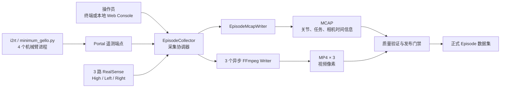

# YAM Teleoperation Data Collection 系统说明

## 1. 文档目的

本文根据 `teleop-data-collection-package` 的 README、配置文件和核心实现整理，用于说明 YAM 双臂遥操作数据采集系统的功能定位、系统设计、数据流、输入输出、质量门禁和运行边界。

## 2. 功能概述

该系统是一套可移植的双臂遥操作数据采集工具。它在机器人遥操作期间同步采集：

- 4 路机械臂状态：左 Leader、右 Leader、左 Follower、右 Follower；
- 3 路 RealSense 视频：高位相机、左侧相机、右侧相机；
- Episode 任务信息、相机内参和时间诊断信息。

系统将一次采集过程组织为一个 Episode，生成 Piper 兼容的 MCAP 与外部 MP4 文件，并在保存和发布前检查帧率、丢帧、时间同步、视频帧数和编码完整性。

核心目标是：

1. 在不干扰机器人实时控制的前提下读取机械臂状态；
2. 保留机械臂与相机的真实采集时间；
3. 保证 MCAP 中的相机帧记录与 MP4 解码帧一一对应；
4. 阻止不完整或发生静默丢帧的数据被当作正式 Episode 发布；
5. 输出可供后续训练、回放、分析和数据平台处理的标准化数据集。

## 3. 系统边界

### 3.1 系统负责

- 连接 `i2rt/minimum_gello.py` 暴露的 Portal 遥测端点；
- 按固定频率读取四个机械臂的关节状态；
- 按配置的分辨率和帧率录制三路 RealSense 视频；
- 将关节状态、任务信息、相机信息和时间诊断写入 MCAP；
- 使用 FFmpeg 将相机像素实时编码为 MP4；
- 管理 Episode 的开始、保存、丢弃、验证、转码和发布；
- 提供终端采集、浏览器控制台、相机测试、数据验证和诊断工具。

### 3.2 系统不负责

- 不直接打开或控制 CAN 接口；
- 不替代 `i2rt/minimum_gello.py` 的 Leader/Follower 控制逻辑；
- 不负责机械臂硬件同步按钮的操作；
- 不负责将数据上传到 Prismax 云端；
- 不默认修饰或伪造原始采集数据来使其通过质量检查。

CAN 仍由现有的四个 `minimum_gello.py` 进程独占。采集系统只通过只读 Portal 接口获取状态，因此不会创建第二条 CAN 控制链路。

## 4. 总体系统设计



### 4.1 主要组件

| 组件 | 主要职责 |
| --- | --- |
| `config.py` | 读取 YAML 配置，解析采集模式、相机、遥测端点、编码参数和任务信息 |
| `telemetry.py` | 通过 Portal 连接四个 `i2rt` 进程，读取带源时间戳和序列号的机械臂快照 |
| `cameras.py` | 按序列号打开 RealSense，相机角色不依赖不稳定的 `/dev/videoN` 编号 |
| `collector.py` | 管理采集状态机、预检、Episode 生命周期、同步写入和异常清理 |
| `queued_collector.py` | 将机械臂状态写入改为队列处理，降低高频采集对主循环的阻塞 |
| `mcap_writer.py` | 生成 Piper 兼容的 ROS 2 CDR MCAP Topic 和消息 |
| `video.py` | 管理每路相机对应的异步 FFmpeg 编码进程和背压队列 |
| `video_pipeline.py` | 验证临时视频、转码、原子发布 H.264/HEVC 最终资产 |
| `quality.py` | 检查 MCAP Topic、采样率、帧间隔、同步、分辨率和视频帧数 |
| `web_console.py` / `web_runtime.py` | 提供本机浏览器控制、预览、机械臂进程管理和采集状态展示 |
| `camera_test.py` | 在不连接机械臂和 MCAP 的情况下独立验证相机、USB、编码和磁盘性能 |
| `offline_repair.py` | 为满足严格条件的 30 Hz 丢帧创建独立修复衍生数据，不覆盖原始数据 |

### 4.2 Package 文件结构

```text
teleop-data-collection-package/
├── README.md                         # 安装、配置、采集、验证和故障诊断说明
├── pyproject.toml                    # Python 包元数据、依赖、CLI 入口和测试配置
├── uv.lock                           # uv 锁定依赖版本，保证环境可复现
├── config.example.yaml               # 完整采集配置示例
├── config.d405_*.yaml                # D405 不同分辨率/发布策略的采集配置
├── camera_test.example.yaml          # 独立相机资格测试配置示例
├── camera_test.d435_*.yaml           # D435 分辨率、线程数等 A/B 测试配置
├── realsense_frame_drop_abc.example.yaml
│                                      # RealSense 丢帧 A/B/C 实验计划示例
├── web_arm_commands.example.json     # Web Console 机械臂启动命令覆盖示例
├── scripts/                           # 部署与数据维护脚本
├── tests/                             # 自动化测试
└── yam_data_collection/               # 主 Python Package
    ├── __init__.py                     # Package 公共接口
    ├── __main__.py                     # python -m 启动入口
    ├── cli.py                          # yam-data-collect CLI 命令路由
    ├── config.py                       # YAML 配置加载、合并与校验
    ├── models.py                       # 遥测、相机帧和时间诊断数据模型
    ├── telemetry.py                    # 只读 Portal 遥测客户端
    ├── cameras.py                      # RealSense 发现与采集后端
    ├── collector.py                    # Episode 状态机与采集协调器
    ├── queued_collector.py             # 队列化 JointState 写入采集器
    ├── mcap_writer.py                  # Piper 兼容 MCAP Writer
    ├── video.py                        # 异步 FFmpeg 编码与转码底层
    ├── video_pipeline.py               # 视频验证、转码和原子发布
    ├── quality.py                      # MCAP 与 MP4 质量检查
    ├── validation_profiles.py          # 30/60 Hz 等验证标准
    ├── dataset_lock.py                 # 数据集并发操作互斥锁
    ├── live_preview.py                 # 非阻塞 Tk 实时预览
    ├── web_console.py                  # 本地 Web UI、API 和进程监督
    ├── web_runtime.py                  # Web Console 生产环境装配层
    ├── runtime_diagnostics.py          # 主机与采集运行指标记录
    ├── camera_test.py                  # 独立相机资格测试
    ├── experiment.py                   # RealSense A/B/C 诊断实验
    ├── offline_repair.py               # 30 Hz 丢帧衍生修复
    └── terminal.py                     # 终端显示辅助工具
```

#### 4.2.1 顶层文件与配置

| 文件 | 作用 |
| --- | --- |
| `README.md` | Package 的主要操作手册，记录当前采集命令、数据布局、验证阈值、相机测试和诊断流程 |
| `pyproject.toml` | 定义 `yam-data-collection` 包、Python 版本范围、基础/可选依赖，以及 `yam-data-collect` 命令入口 |
| `uv.lock` | 锁定完整依赖树，配合 `uv sync` 创建一致的部署环境 |
| `.gitignore` | 排除本地数据集、相机测试结果、诊断输出、标定图片、虚拟环境等非源码资产 |
| `config.example.yaml` | 通用主配置模板，包含采集参数、Portal 端点、相机、采集模式和 `task_info` |
| `config.d405_640x480.production.yaml` | D405 640×480 生产配置实例 |
| `config.d405_640x480.validation.yaml` | D405 640×480 验证配置实例，与正式生产目录隔离 |
| `config.d405_848x480.validation.yaml` | D405 848×480 候选配置，用于资格验证和对比测试 |
| `config.d405_848x480.h264_final.yaml` | 848×480、最终直接发布 H.264 的配置实例，不需要离线 HEVC 转码 |
| `camera_test.example.yaml` | 相机独立资格测试模板，不依赖 Portal、CAN 或 MCAP |
| `camera_test.d435_1080p.yaml` | D435 1080p 相机测试配置 |
| `camera_test.d435_720p.yaml` | D435 720p 相机测试配置 |
| `camera_test.d435_720p_threads1.yaml` | D435 720p、单编码线程测试配置 |
| `camera_test.d435_720p_threads2.yaml` | D435 720p、双编码线程测试配置 |
| `realsense_frame_drop_abc.example.yaml` | 定义 CPU 集合、USB 控制器拓扑、实验次数和输出目录等 A/B/C 对照条件 |
| `web_arm_commands.example.json` | 显式指定四个机械臂进程的启动参数和 Portal 就绪探测；用于覆盖 Web Runtime 默认命令 |

`config.*.yaml` 和 `camera_test.*.yaml` 是针对不同主机、相机 Profile 或实验目的的实例。正式部署时应复制或维护站点专用配置，不能直接假定示例中的相机序列号、CPU 编号和 USB 拓扑适用于其他主机。

#### 4.2.2 `yam_data_collection/` 主程序

```text
yam_data_collection/
├── __init__.py
├── __main__.py
├── cli.py
├── config.py
├── models.py
├── telemetry.py
├── cameras.py
├── collector.py
├── queued_collector.py
├── mcap_writer.py
├── video.py
├── video_pipeline.py
├── quality.py
├── validation_profiles.py
├── dataset_lock.py
├── live_preview.py
├── web_console.py
├── web_runtime.py
├── runtime_diagnostics.py
├── camera_test.py
├── experiment.py
├── offline_repair.py
└── terminal.py
```

| 文件 | 作用 |
| --- | --- |
| `__init__.py` | 暴露 Package 的基础公共接口，例如 `DatasetConfig` 和 `load_config` |
| `__main__.py` | 支持通过 `python -m yam_data_collection` 启动 CLI |
| `cli.py` | 注册所有 `yam-data-collect` 子命令，将参数路由到采集、验证、转码和诊断实现 |
| `config.py` | 将 YAML 转换为强类型配置对象，合并 Capture Mode，并验证编码器、CPU 集合和必填字段 |
| `models.py` | 定义模块间共享的不可变数据模型：`RobotSnapshot`、`CameraFrame`、`CameraTimingSample` |
| `telemetry.py` | 封装只读 Portal Client，处理连接、超时、重连和遥测字段校验 |
| `cameras.py` | RealSense 设备发现和采集后端，按物理序列号绑定角色并生成带时间证据的 `CameraFrame` |
| `collector.py` | 核心协调器，管理状态机、预检、采集线程、Episode 创建/保存/删除和资源关闭 |
| `queued_collector.py` | `EpisodeCollector` 的队列化变体，将高频 JointState MCAP 序列化移出采集线程；当前由 `scripts/capture_queued.py` 使用 |
| `mcap_writer.py` | 注册 ROS 2 Schema，写入 JointState、CameraInfo、Task Info 和 Frame Timing Diagnostics |
| `video.py` | 实时异步 FFmpeg Writer、队列指标、编码错误处理和离线视频转码底层实现 |
| `video_pipeline.py` | 管理 `.pending`、`videos_live`、最终 Episode，执行视频身份验证、转码和原子替换 |
| `quality.py` | 读取 MCAP/MP4 并执行频率、Gap、同步、分辨率、Codec 和帧数检查 |
| `validation_profiles.py` | 集中定义 `yam_30hz`、`yam_60hz`、`piper_compatible` 等验证标准 |
| `dataset_lock.py` | 使用文件锁对同一数据集执行互斥保护，防止采集与高负载转码并发运行 |
| `live_preview.py` | 提供与采集热路径隔离的 Tk 相机预览和关节趋势；预览变慢时只丢预览数据，不影响正式采集 |
| `web_console.py` | 实现本地 HTTP 页面、预览缓存、状态接口、机械臂子进程监督和基础 Web 控制逻辑 |
| `web_runtime.py` | 将 Web Console 与真实配置、Collector、Preview 和四个 `i2rt` 进程连接起来 |
| `runtime_diagnostics.py` | 低频记录 CPU、温度、磁盘、内存、编码器和队列状态，不进入时间敏感的回调路径 |
| `camera_test.py` | 独立运行单路、多路相机资格测试，生成 MP4、测试配置和 `report.json` |
| `experiment.py` | 使用正式采集链路运行限时、可重复的 RealSense A/B/C 掉帧实验，并生成比较报告 |
| `offline_repair.py` | 只针对严格符合条件的 30 Hz `delta=3` 掉帧创建可追溯的衍生 Episode 和修复 Manifest |
| `terminal.py` | 提供终端颜色和操作状态等轻量显示工具 |

#### 4.2.3 `scripts/` 运维与数据工具

| 文件 | 作用 |
| --- | --- |
| `capture_queued.py` | 启动 `QueuedEpisodeCollector`，是当前队列化状态写入采集入口 |
| `calibrate_realsense_intrinsics.py` | 使用棋盘格标定指定 RealSense Profile，输出标定结果和可复制到 YAML 的内参片段 |
| `check_joint_camera_sync.py` | 单独复现正式 Joint-Camera 同步检查，支持单个 MCAP 或整个数据集 |
| `summarize_dataset_duration.py` | 统计 Episode 数量、MCAP 时间跨度和可选的视频时长 |
| `mcap_task_info.py` | 实现 MCAP `/task_info` JSON 的读取与重写逻辑 |
| `show_mcap_task_info.py` | 显示一个或多个 MCAP 中的 `/task_info` 内容 |
| `update_mcap_task_info.py` | 更新 MCAP 中的 `task_description` 和 `task_id` |

这些脚本主要用于部署、标定、离线检查和元数据维护，不属于实时采集热路径。

#### 4.2.4 `tests/` 自动化测试

| 测试文件或类别 | 覆盖范围 |
| --- | --- |
| `test_cli.py`、`test_config.py` | CLI 参数、配置解析、模式合并和校验 |
| `test_cameras.py`、`test_telemetry.py` | 相机发现/时间语义和 Portal 遥测读取 |
| `test_collector_safety.py`、`test_queued_collector.py` | Episode 状态、安全清理、队列背压和异步状态写入 |
| `test_video_pipeline.py`、`test_video_safety.py` | 视频转码、帧数门禁、发布和失败恢复 |
| `test_validation_profiles.py`、`test_mcap_contract.py` | 验证阈值和 Piper 兼容 MCAP Topic/Schema 契约 |
| `test_camera_test.py`、`test_live_preview.py` | 相机资格测试与非阻塞预览 |
| `test_web_console.py` | Web 状态、API、预览和机械臂进程监督 |
| `test_experiment.py` | A/B/C 实验计划、运行与报告输出 |
| `test_offline_repair.py` | 30 Hz 修复资格、衍生资产和来源追踪 |

## 5. 采集状态机

```text
IDLE
  │ 开始 Episode
  ▼
ARMING
  │ 2 秒全负载健康检查通过
  ▼
RECORDING
  │ 保存或丢弃
  ▼
FINALIZING
  │ 关闭 MCAP/FFmpeg、验证并发布或清理
  ▼
IDLE
```

### 5.1 IDLE

- 相机和遥测采集器可以保持运行，但当前没有活动 Episode；
- 系统持续维护相机预检窗口；
- 操作员可通过终端或 Web Console 发起新 Episode。

### 5.2 ARMING

正式录制前执行约 2 秒的全负载检查：

- 四路 Portal 状态必须持续更新；
- 三路相机必须持续产生新帧；
- FFmpeg 进程不能退出或报告写入错误；
- 编码队列不能异常增长；
- 管道写入耗时不能超过保护阈值；
- 相机帧间隔必须符合当前验证配置。

ARMING 失败时不会生成正式数据，系统丢弃此次尝试并返回 `IDLE`。

### 5.3 RECORDING

- 按配置频率采样机械臂状态，正式模式通常为 180 Hz；
- 每个 RealSense 相机由独立线程读取，避免顺序读取导致三路相机相互阻塞；
- 关节数据和相机时间信息写入 MCAP；
- 相机像素分别写入三个 FFmpeg 编码队列；
- 编码队列满时直接中止 Episode，而不是静默丢弃视频帧。

### 5.4 FINALIZING

- 等待进行中的相机和状态写入结束；
- 关闭 MCAP Writer 和三个 FFmpeg Writer；
- 检查 MCAP 与视频是否可读取、帧数是否一致；
- 根据配置直接发布 H.264，或保留 pending 数据等待离线 HEVC 转码；
- 失败时清理不完整文件，或保留具有诊断价值的 pending 资产。

## 6. 数据流

### 6.1 启动阶段

1. 读取 YAML 配置和指定的 `--mode`；
2. 解析数据集路径、四个遥测端点、三个相机序列号、内参和编码参数；
3. 获取数据集锁，防止采集与离线转码同时操作同一目录；
4. 连接 Portal，并按物理序列号启动 RealSense；
5. 执行遥测和相机预检。

### 6.2 机械臂状态流

```text
Leader/Follower 硬件
  → minimum_gello.py 读取 CAN 状态
  → Portal 遥测端点
  → PortalTelemetryClient
  → RobotSnapshot
  → EpisodeMcapWriter
  → JointState Topic
```

每个 `RobotSnapshot` 包含：

- `role`：机械臂角色；
- `source_timestamp_ns`：`i2rt` 实际读取硬件状态的时间；
- `sequence`：遥测序列号；
- `position`：7 个关节值，包含 6 个机械臂关节和 gripper；
- `velocity`、`effort`：Follower 提供完整值，Leader 为兼容 Piper 保持为空。

MCAP 的 `header.stamp` 保存硬件状态源时间，`log_time` 保存采集器的固定频率采样时间。两者分离后，可以识别“RPC 返回了旧状态”这类遥测延迟问题。

### 6.3 相机数据流

```text
RealSense 相机
  → Camera Worker
  → CameraFrame + Capture Timestamp
  ├─→ MCAP CameraInfo
  ├─→ Frame Timing Diagnostics
  └─→ Async FFmpeg Writer → MP4
```

MCAP 不保存视频像素，只保存每个已接受视频帧对应的 `CameraInfo` 与时间戳。实际图像分别保存在 `cam_high.mp4`、`cam_left.mp4` 和 `cam_right.mp4` 中。

当 RealSense 提供可信的 Global Time 时，系统优先使用映射后的设备采集时间进行相机同步判断，同时保留主机接收时间用于定位 USB、调度和队列延迟。

### 6.4 保存与发布流

```text
实时录制
  → .pending/<episode_id>/<episode_id>.mcap
  → videos_live/<episode_id>/*.mp4
  → 完整性验证
  ├─ H.264 final：直接原子发布
  └─ HEVC final：离线串行转码后原子发布
  → <episode_id>/<episode_id>.mcap + videos/*.mp4
```

发布门禁要求每路相机满足：

```text
MCAP CameraInfo 数量
    = 实时 MP4 解码帧数
    = 最终 MP4 解码帧数（发生转码时）
```

发布过程不会为了通过验收而自动插帧、重排时间戳或忽略帧数差异。

## 7. 输入

| 输入类别 | 内容 | 来源 |
| --- | --- | --- |
| 采集配置 | 数据集路径、模式、状态频率、编码器、队列、CPU 亲和性 | YAML 配置文件 |
| 遥测配置 | 4 个机械臂角色及 Portal host/port | YAML `telemetry` |
| 相机配置 | 角色、序列号、分辨率、FPS、格式、Frame ID、内参 | YAML `cameras` / `capture_modes` |
| 任务信息 | Operator、任务名称、描述、任务 ID、Skill、Object、Subtask | YAML `task_info` |
| 机械臂状态 | Position、Velocity、Effort、源时间戳、Sequence | 4 个 Portal 端点 |
| 视频帧 | 三路 RealSense 图像、设备帧号和时间戳 | D435/D405 等 RealSense |
| 操作指令 | 开始、保存、丢弃、退出 | 终端按键或本地 Web Console |
| 外部工具 | H.264/HEVC 编码及视频探测 | `ffmpeg` / `ffprobe` |

## 8. 输出

### 8.1 正式 Episode

当前发布管线按 Episode 自包含目录组织最终数据：

```text
<dataset>/
  record_config.yaml
  <episode_id>/
    <episode_id>.mcap
    videos/
      cam_high.mp4
      cam_left.mp4
      cam_right.mp4
```

### 8.2 采集和处理中间文件

```text
<dataset>/
  .pending/<episode_id>/<episode_id>.mcap
  videos_live/<episode_id>/
    cam_high.mp4
    cam_left.mp4
    cam_right.mp4
  runtime_diagnostics/*.jsonl
  deleted_episode_durations.txt
```

- `.pending`：已经结束实时采集，但尚未完成最终发布的 MCAP；
- `videos_live`：实时低开销编码的视频；
- `runtime_diagnostics`：CPU、温度、磁盘、编码器和队列等运行证据；
- `deleted_episode_durations.txt`：因验证失败、录制错误或人工删除而丢弃的 Episode 时长统计。

### 8.3 MCAP Topic

| Topic | 类型 | 内容 |
| --- | --- | --- |
| `/robot/arm_left_leader/joint_states` | `sensor_msgs/msg/JointState` | 左 Leader 关节状态 |
| `/robot/arm_right_leader/joint_states` | `sensor_msgs/msg/JointState` | 右 Leader 关节状态 |
| `/robot/arm_left_follow/joint_states` | `sensor_msgs/msg/JointState` | 左 Follower 关节状态 |
| `/robot/arm_right_follow/joint_states` | `sensor_msgs/msg/JointState` | 右 Follower 关节状态 |
| `/robot/camera/cam_high/image_raw/compressed/camera_info` | `sensor_msgs/msg/CameraInfo` | 高位相机内参与帧时间 |
| `/robot/camera/cam_left/image_raw/compressed/camera_info` | `sensor_msgs/msg/CameraInfo` | 左侧相机内参与帧时间 |
| `/robot/camera/cam_right/image_raw/compressed/camera_info` | `sensor_msgs/msg/CameraInfo` | 右侧相机内参与帧时间 |
| `/task_info` | `std_msgs/msg/String` | JSON 格式任务元数据 |
| `/diagnostics/frame_timing` | `std_msgs/msg/String` | 设备帧号、采集时间、主机接收时间等诊断信息 |

## 9. 采集模式

采集模式由配置文件中的 `capture_modes` 定义，并通过 `--mode` 显式选择。模式会同时固定：

- 每个相机的分辨率、FPS 和数据格式；
- 机械臂状态采样频率；
- 输出目录；
- 验证 Profile；
- 实时和最终视频编码方式。

| 模式 | 典型相机配置 | 状态采样 | 同步要求 |
| --- | --- | --- | --- |
| `30hz` | 三路 30 FPS，常用 1280×720 | 180 Hz | 相机与 Joint-Camera 通常不超过 34 ms |
| `60hz` | D435 960×540，D405 640×480 或 848×480 | 180 Hz | 相机与 Joint-Camera 通常不超过 17 ms |

实际分辨率、编码器和目录以所选 YAML 配置为准，不能只根据模式名称推断。

## 10. 质量验证

### 10.1 正式质量检查

- 必需 Topic 是否存在；
- 四路关节状态频率是否满足要求；
- 每路相机实际采集 FPS 是否达标；
- 相机最大帧间隔是否超过阈值；
- 三路相机之间的同步偏差；
- 相机帧与最近机械臂源时间戳的偏差；
- 相机分辨率和内参是否匹配配置；
- MP4 是否可被 `ffprobe` 读取；
- MP4 Codec、分辨率和解码帧数是否正确；
- MCAP CameraInfo 数量是否与对应视频帧数一致。

主要验证 Profile：

| Profile | 相机频率 | 最大帧间隔 | 相机同步 | Joint-Camera 同步 |
| --- | --- | --- | --- | --- |
| `yam_30hz` | 30 ± 0.5 Hz | ≤ 69 ms | ≤ 34 ms | ≤ 34 ms |
| `yam_60hz` | 59.0–60.5 Hz | ≤ 69 ms | ≤ 17 ms | ≤ 17 ms |
| `piper_compatible` | 自动识别 15/30/60 Hz | ≤ 69 ms | ≤ 34 ms | ≤ 34 ms |
| `yam_60hz_strict` | 60 ± 0.5 Hz | ≤ 35 ms | ≤ 17 ms | ≤ 17 ms |

`yam_60hz_strict` 主要用于检查历史严格模式数据，不是普通 60 Hz 采集的默认标准。

### 10.2 完整性发布门禁与质量验收的区别

发布门禁主要判断“文件是否忠实且完整”，例如 MCAP 是否可读、视频是否可解码、帧数是否一致。正式质量验收则判断采集质量是否满足帧率和同步标准。

因此，一个真实记录了相机掉帧的 Episode 可以被忠实转码并发布，但正式 `validate` 仍会报告失败。系统不会通过转码掩盖源数据质量问题。

## 11. 操作入口

| 命令 | 用途 |
| --- | --- |
| `discover-cameras` | 按物理序列号发现 RealSense |
| `check` | 检查 Portal 遥测，并可启动相机读取测试 |
| `capture` | 运行终端交互式 Episode 采集 |
| `web` | 启动本机浏览器控制台 |
| `camera-test` | 不连接机器人，单独验证相机与编码链路 |
| `validate` | 验证单个 MCAP 和对应视频 |
| `validate-dataset` | 验证数据集中的全部 Episode |
| `transcode` | 将单个 pending Episode 的实时视频转为最终 HEVC |
| `transcode-dataset` | 串行转码全部 pending Episode |
| `publish-pending` | 不重新编码，直接发布验证通过的 H.264 Episode |
| `capture-auto-repair` | 30 Hz 采集后，对符合条件的 Episode 创建修复衍生版本 |
| `repair-30hz` | 手动创建独立的 30 Hz 丢帧修复衍生数据 |
| `experiment` / `experiment-report` | 运行并汇总 RealSense 掉帧 A/B/C 对照实验 |

终端采集的主要控制键：

- `Space`：执行健康探测并创建 Episode；
- `Enter`：保存当前 Episode；
- `q`：丢弃当前 Episode；
- `Ctrl+C`：安全丢弃活动 Episode 并关闭资源。

## 12. Web Console 设计

- 默认仅监听 `127.0.0.1`，不提供公网认证；
- 启动 Web 服务本身不会自动启动机械臂或相机；
- 可按既定顺序启动四个 `minimum_gello.py` 进程并等待 Portal 就绪；
- 提供三路相机预览、四路关节趋势、采集状态和运行消息；
- 操作员仍需完成物理教学手柄同步，Web 页面不能替代硬件步骤；
- 如需远程使用，应通过经过认证的安全隧道访问，不能直接暴露监听地址。

## 13. 故障保护与数据完整性策略

- **单一 CAN Owner**：采集器不打开 CAN，避免与机器人控制进程争用硬件；
- **数据集锁**：禁止实时采集与高负载离线转码同时运行；
- **序列号绑定相机**：避免 `/dev/videoN` 变化造成左右相机角色互换；
- **标定门禁**：正式采集默认拒绝缺少有效内参的相机；
- **独立相机线程**：防止一台相机阻塞其他相机；
- **队列背压保护**：队列满时中止 Episode，不静默丢帧；
- **临时文件与原子发布**：先写 `.partial`/`.pending`，验证通过后再移动到正式路径；
- **帧数一致性**：MCAP 与每路视频必须保持一一对应；
- **源时间保真**：同时保存源时间、采集器时间和主机接收时间；
- **原始数据保护**：30 Hz Repair 输出到独立 derived 数据集，不覆盖原始 Episode；
- **可诊断失败**：对具有分析价值的失败资产和运行指标进行保留。

## 14. 部署依赖与注意事项

- 推荐 Python 3.11，支持范围为 Python 3.10–3.12；
- 需要 `ffmpeg` 和 `ffprobe`；
- RealSense 采集需要与主机 Librealsense 匹配的 `pyrealsense2`；
- `i2rt` 是独立依赖，不包含在该 package 中；
- 更换主机、相机、USB 拓扑、分辨率或 FPS 后，应重新执行相机测试和内参确认；
- 数据目录、相机测试、诊断运行和标定图片是本地资产，不随源码 Git 仓库保存；
- 正式数据应使用独立存储策略备份，并由其他流程上传到数据平台。

## 15. 总结

`teleop-data-collection-package` 是 YAM 双臂遥操作系统的数据记录与质量控制层。它将四路机械臂遥测和三路 RealSense 视频按统一时间语义组织成 Episode，通过 MCAP 保存结构化状态与时间证据，通过 MP4 保存视频像素，并以严格的预检、背压、帧数一致性和同步验证保证输出数据可追溯、可诊断且适合后续机器人学习使用。
